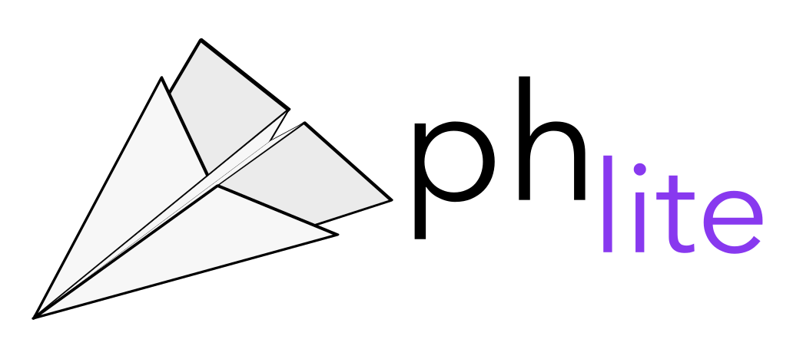

<div align="center">



<h1>phlite</h1>

<span>/flaɪt/</span>

Persistent homology that's light on memory usage.

[](https://pypi.org/project/phlite/)
[](https://crates.io/crates/phlite)
[](https://phlite.tomchaplin.xyz)
[](https://docs.rs/phlite)

**[Documentation](https://phlite.tomchaplin.xyz/book/)** ·
**[Playground](https://phlite.tomchaplin.xyz/playground/)** ·
**[Python API](https://phlite.tomchaplin.xyz/api/)** ·
**[Rust API](https://docs.rs/phlite)**

</div>

## Why phlite?

The state of the art for computing persistent homology (PH) of Vietoris–Rips filtrations is
[Ripser](https://github.com/Ripser/ripser) [[1]](#1), which its authors report outperforms other codes by a factor of
more than 40 in computation time and more than 15 in memory. Memory efficiency matters as much as speed: memory is
usually what limits PH, especially on consumer hardware, and allocating it takes time.

Ripser's efficiency has made it, and with it the Vietoris–Rips filtration, the default choice in many applications.
Because it is so carefully specialised to Vietoris–Rips, other filtrations have needed forks and rewrites to get the
same benefits: [flagser](https://github.com/luetge/flagser) [[3]](#3) for directed flag complexes,
[Cubical Ripser](https://github.com/shizuo-kaji/CubicalRipser_3dim) [[4]](#4) for images,
[giotto-ph](https://github.com/giotto-ai/giotto-ph) [[9]](#9) to run in parallel.

**phlite separates the parts of Ripser and its relatives that are specific to Vietoris–Rips from those that work for
any filtration**, and makes the latter available behind generic traits. You describe your filtration as a *matrix
oracle*, a lazy description of its boundary matrix, and phlite reduces it with the techniques those packages
pioneered: clearing, cohomology, apparent and emergent pairs, storing V rather than R, lock-free parallel reduction,
and more. Each technique is optional and documented, with notes on when it helps.

On top of that framework, phlite now comes with batteries for many filtrations, from Python and Rust: Vietoris–Rips,
alpha, Delaunay–Čech, Čech and witness complexes, weighted and DTM-Rips, cubical complexes of images (periodic too,
and giotto-tda's filtrations of binary images), path homology, directed flag complexes, Dowker complexes, flag
complexes of graphs, magnitude homology, extended persistence, and explicit chain complexes of any kind.

And the same generic traits carry the constructions around persistence to any filtration: **maps of filtrations**
(the image, kernel and cokernel barcodes of a map, and its whole six-pack, with representatives), **zigzag
persistence**, **persistence over the integers** (the barcode over Q and the primes of the torsion) and **spectral
sequences** (a page at a time, with groups and generators, over a field or Z).

## Where to start

**Try it in your browser.** The [playground](https://phlite.tomchaplin.xyz/playground/) runs phlite (compiled to
WebAssembly) on point clouds, images, networks and chain complexes you draw or upload, and shows barcodes,
representatives and the filtration as you edit. Nothing to install.

**From Python**, install every package with

```sh
pip install phlite
```

```python
from phlite.clouds import rips

barcode = rips(points=X, max_dim=1)    # X: an (n, d) numpy array
barcode.pairings[1]                    # (birth, death) of the finite H1 bars
```

then see [the Python guide](https://phlite.tomchaplin.xyz/book/python/index.html) and the
[example notebooks](https://phlite.tomchaplin.xyz/book/python/notebooks.html). Each kind of input has its own package,
sharing the namespace `phlite`:

| Python package | Rust crate | For | Compare with |
|---|---|---|---|
| [`phlite.clouds`](phlite_clouds/README.md) | `phlite_clouds` | point clouds and distance matrices: Vietoris–Rips (dense or sparse), weighted and DTM-Rips, alpha and Delaunay–Čech complexes | Ripser, giotto-ph, GUDHI |
| [`phlite.networks`](phlite_networks/README.md) | `phlite_networks` | weighted graphs and digraphs: (grounded) path homology, directed flag, Dowker and ordered-tuple complexes, flag complexes | grpphati, flagser, GUDHI |
| [`phlite.images`](phlite_images/README.md) | `phlite_images` | images and volumes: cubical complexes, T- and V-constructions | Cubical Ripser, GUDHI |
| [`phlite.clouds`](phlite_clouds/README.md) (also) | | Čech and witness complexes; six-packs of subsets and of maps of point clouds | GUDHI, phimaker |
| [`phlite.complexes`](phlite_complexes/README.md) | `phlite_complexes` | any chain complex you build, with any filtration: extended persistence, maps and six-packs, zigzags, the integers, spectral sequences | PHAT, LoPHAT, GUDHI, phimaker, Dionysus, Kenzo |
| `phlite.core` | [`phlite_bindings`](phlite_bindings/README.md) | what the others share: `Algorithm`, `Barcode`, `SixPack` and `SpectralSequence` | |

**From Rust, for your own filtration**, the core crate [`phlite`](phlite/README.md) has the matrix oracle traits, the
reduction algorithms and barcodes. The book walks through [how phlite is built](https://phlite.tomchaplin.xyz/book/design/oracles.html)
and [a tutorial](https://phlite.tomchaplin.xyz/book/tutorial/index.html) implementing a filtration step by step, adding
one optimisation at a time; the [API docs](https://docs.rs/phlite) have the details.

## Standing on the shoulders of others

Almost every technique in phlite comes from other software, and we are grateful to their authors:

* **[Ripser](https://github.com/Ripser/ripser)** [[1]](#1): cohomology with clearing, storing V and recomputing columns
  of R on demand, apparent and emergent pairs, leaving zero-persistence pairs out of the reduction, truncating at the
  enclosing radius, union-find in dimension 0, and encoding simplices as integers.
* **Chen and Kerber** [[2]](#2): clearing (the "twist").
* **[giotto-ph](https://github.com/giotto-ai/giotto-ph)** [[9]](#9) and **Morozov and Nigmetov** [[8]](#8): the
  structure of the parallel reduction, and its lock-free algorithm.
* **[OAT](https://github.com/OpenAppliedTopology/oat_rust)** [[10]](#10): reducing a column by lazily merging sorted
  columns.
* **[PHAT](https://github.com/blazs/phat)** [[11]](#11): pivot columns (a bit tree over the rows) and storing R, for
  explicit complexes; and [LoPHAT](https://github.com/tomchaplin/lophat), its lock-free sibling.
* **[flagser](https://github.com/luetge/flagser)** [[3]](#3): directed flag complexes, and the deduplicating heap
  behind phlite's opt-in `'dynamic'` columns.
* **[Cubical Ripser](https://github.com/shizuo-kaji/CubicalRipser_3dim)** [[4]](#4) and
  **[GUDHI](https://gudhi.inria.fr)** [[12]](#12): cubical complexes, alpha complexes, weighted Rips and extended
  persistence, which phlite follows (and is tested against).
* **[grpphati](https://github.com/tomchaplin/grpphati)**: grounded persistent path homology [[7]](#7).
* **[Perseus](https://people.maths.ox.ac.uk/nanda/perseus/)** (Mischaikow and Nanda) [[13]](#13): discrete Morse
  reductions before reducing (the filtered discrete gradient of cubical volumes; coreductions and elimination of unit
  pairs for magnitude homology), word-parallel domination tests in the edge collapse of Rips complexes (after Glisse
  and Pritam [[18]](#18)), sorted enumeration with faces by binary search, and finding the primes of the torsion from a
  fraction-free reduction over Z (persistence over the integers).
* **Cohen-Steiner, Edelsbrunner, Harer and Morozov** [[14]](#14) and **[phimaker](https://github.com/tomchaplin/phimaker)**:
  the image, kernel and cokernel reductions behind phlite's six-packs.
* **Dey and Hou's FastZigzag** [[15]](#15): zigzag persistence as ordinary persistence of a coned up-down filtration;
  tested against [Dionysus](https://mrzv.org/software/dionysus2/) (Morozov).
* **[Kenzo](https://github.com/miguelmarco/kenzo)** (Romero, Rubio and Sergeraert) [[16]](#16): spectral sequences over
  the integers, which phlite's are tested against (as against
  [spectral-sequence-engine](https://pypi.org/project/spectral-sequence-engine/) and
  [PerMaViss](https://github.com/atorras1618/PerMaViss)).
* **Hepworth and Willerton** [[17]](#17), **Asao**, **Hepworth and Roff**: magnitude homology and the magnitude-path
  spectral sequence, after [gramag](https://github.com/tomchaplin/gramag), against which (and Perseus) it is tested.
* **GUDHI** again for Čech, witness and periodic cubical complexes, and
  **[giotto-tda](https://github.com/giotto-ai/giotto-tda)** for the filtrations of binary images.

If you use Julia, [Ripserer.jl](https://github.com/mtsch/Ripserer.jl) [[6]](#6) shares phlite's aim of making Ripser's
techniques extensible to new filtrations, and we recommend it.

## Performance, briefly

phlite is benchmarked against each of the packages above on the inputs they're built for (every barcode is checked to
agree). On one thread, phlite is faster on most of their own inputs:

* Vietoris–Rips: 1–2.2× faster than giotto-ph and 1.4–7× faster than ripser;
* directed flag complexes: 1.4–1.9× faster than flagser;
* GrPPH and path homology: 24–100× faster than grpphati;
* flag complexes of graphs, extended persistence and weighted Rips: 3–18×, 2.5–5.5× and over 50× faster than GUDHI;
* explicit Rips complexes: 11–26× faster than PHAT, and cell complexes 1.1–2× faster.

It is slower in places too, and often uses more memory:

* Cubical Ripser is 1.5–1.7× faster on 3D volumes (in 2D the two are level, or phlite up to 2× faster);
* PHAT is up to 1.4× faster on cubical and dense complexes (level on meshes);
* GUDHI's alpha and Delaunay–Čech complexes are 7–8× faster on a million points in the plane (phlite is level or
  up to 2.4× faster up to 100,000 points, and in space);
* on point clouds with long bars, Rips' default uses far more memory than giotto-ph (546 MB against 7 MB on a noisy
  sphere of 400 points; other column choices narrow this), and flagser uses 2–4× less memory than phlite.

These are a few families of inputs on one machine, so treat them as indicative. The
[benchmarks appendix](https://phlite.tomchaplin.xyz/book/appendix/benchmarks.html) explains what is measured, and
[`python-tests/BENCHMARKS.md`](python-tests/BENCHMARKS.md) has every number, for every configuration.

## Correctness

Every Python pipeline is fuzzed (with Hypothesis) against reference implementations (ripser, giotto-ph, GUDHI,
grpphati, flagser, PHAT, LoPHAT, Cubical Ripser and PathHomFast) or, where there is none, against brute force, and
path homology was also compared with Chowdhury and Mémoli's MATLAB code; representatives are checked from first
principles. The Rust core has property tests of every algorithm and
column representation, and a checker for [the contract](https://phlite.tomchaplin.xyz/book/design/contract.html) a
matrix oracle must satisfy. See [testing](https://phlite.tomchaplin.xyz/book/appendix/testing.html).

## The repository

* `phlite`, `phlite_complexes`, `phlite_clouds`, `phlite_networks`, `phlite_images`, `phlite_bindings`: the crates
  (each crate with a `python` feature is also the Python package of the table above). Every crate and package is
  released together, on one version.
* `phlite_meta`: the Python metapackage `phlite`, which installs every package.
* `python-tests`: the fuzz tests and benchmarks against the reference implementations ([README](python-tests/README.md)).
* `phlite_web`: the playground ([README](phlite_web/README.md)).
* `docs`: the book, the Python API reference, the notebooks and the landing page, published at
  [phlite.tomchaplin.xyz](https://phlite.tomchaplin.xyz).

`just test` runs every test, and `just --list` shows the rest.

## Use of AI

phlite was started by hand in April 2024. Since November 2026, much of its development (the commits marked
`Co-Authored-By: Claude`, about half of the history) has been done with Anthropic's Claude, through Claude Code:
code, tests, benchmarks and documentation, directed and reviewed by the author, and checked by the tests and fuzzing
against other implementations described above.

## References

<a id="1">[1]</a>
Bauer, Ulrich. "Ripser: efficient computation of Vietoris–Rips persistence barcodes." Journal of Applied and Computational Topology 5.3 (2021): 391-423. [GitHub.](https://github.com/Ripser/ripser)

<a id="2">[2]</a>
Chen, Chao, and Michael Kerber. "Persistent homology computation with a twist." Proceedings 27th European Workshop on Computational Geometry. Vol. 11. 2011.

<a id="3">[3]</a>
Lütgehetmann, Daniel, et al. "Computing persistent homology of directed flag complexes." Algorithms 13.1 (2020): 19. [GitHub.](https://github.com/luetge/flagser)

<a id="4">[4]</a>
Kaji, Shizuo, Takeki Sudo, and Kazushi Ahara. "Cubical Ripser: software for computing persistent homology of image and volume data." arXiv:2005.12692 (2020). [GitHub.](https://github.com/shizuo-kaji/CubicalRipser_3dim)

<a id="5">[5]</a>
Tralie, Christopher, Nathaniel Saul, and Rann Bar-On. "Ripser.py: A lean persistent homology library for Python." Journal of Open Source Software 3.29 (2018): 925. [GitHub.](https://github.com/scikit-tda/ripser.py)

<a id="6">[6]</a>
Čufar, Matija. "Ripserer.jl: flexible and efficient persistent homology computation in Julia." Journal of Open Source Software 5.54 (2020): 2614. [GitHub.](https://github.com/mtsch/Ripserer.jl)

<a id="7">[7]</a>
Chaplin, Thomas, Heather A. Harrington, and Ulrike Tillmann. "Grounded persistent path homology: a stable, topological descriptor for weighted digraphs." arXiv:2210.11274 (2022).

<a id="8">[8]</a>
Morozov, Dmitriy, and Arnur Nigmetov. "Towards lockfree persistent homology." Proceedings of the 32nd ACM Symposium on Parallelism in Algorithms and Architectures (2020). [DOI.](https://doi.org/10.1145/3350755.3400244)

<a id="9">[9]</a>
Pérez, Julián Burella, et al. "giotto-ph: A Python library for high-performance computation of persistent homology of Vietoris–Rips filtrations." arXiv:2107.05412 (2021). [GitHub.](https://github.com/giotto-ai/giotto-ph)

<a id="10">[10]</a>
Open Applied Topology (OAT). [GitHub.](https://github.com/OpenAppliedTopology/oat_rust)

<a id="11">[11]</a>
Bauer, Ulrich, Michael Kerber, Jan Reininghaus, and Hubert Wagner. "PHAT – Persistent Homology Algorithms Toolbox." Journal of Symbolic Computation 78 (2017): 76-90. [GitHub.](https://github.com/blazs/phat)

<a id="12">[12]</a>
The GUDHI Project. GUDHI User and Reference Manual. [gudhi.inria.fr](https://gudhi.inria.fr)

<a id="13">[13]</a>
Mischaikow, Konstantin, and Vidit Nanda. "Morse theory for filtrations and efficient computation of persistent homology." Discrete & Computational Geometry 50 (2013): 330-353. [Perseus.](https://people.maths.ox.ac.uk/nanda/perseus/)

<a id="14">[14]</a>
Cohen-Steiner, David, Herbert Edelsbrunner, John Harer, and Dmitriy Morozov. "Persistent homology for kernels, images, and cokernels." Proceedings of the 20th ACM-SIAM Symposium on Discrete Algorithms (2009).

<a id="15">[15]</a>
Dey, Tamal K., and Tao Hou. "Fast computation of zigzag persistence." 30th European Symposium on Algorithms (ESA 2022). [GitHub.](https://github.com/TDA-Jyamiti/fzz)

<a id="16">[16]</a>
Romero, Ana, Julio Rubio, and Francis Sergeraert. "Computing spectral sequences." Journal of Symbolic Computation 41.10 (2006): 1059-1079.

<a id="17">[17]</a>
Hepworth, Richard, and Simon Willerton. "Categorifying the magnitude of a graph." Homology, Homotopy and Applications 19.2 (2017): 31-60.

<a id="18">[18]</a>
Glisse, Marc, and Siddharth Pritam. "Swap, shift and trim to edge collapse a filtration." 38th International Symposium on Computational Geometry (SoCG 2022).
