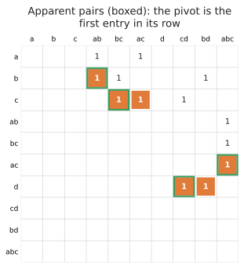

# Apparent and emergent pairs

Most columns of most filtrations need no reduction at all. These two tricks, both from Ripser (Bauer), finish such
columns without reducing them, and often without even building them.

## Apparent pairs

A pair \\((r, c)\\) is **apparent** if

- \\(r\\) is the pivot of column \\(c\\) (the youngest face of \\(c\\)), and
- \\(c\\) is the *first* column with an entry in row \\(r\\) (the oldest coface of \\(r\\)).

Then \\((r, c)\\) is a persistence pair, whatever else is in the matrix: no earlier column can have pivot \\(r\\)
(they have no entry in row \\(r\\)), so column \\(c\\) needs no reduction and owns \\(r\\).

In the running example every pair is apparent (boxed): each pivot is the first entry in its row.
Only ac and bd, which give birth to loops, need reducing.

Recognising one takes two lookups: the pivot of \\(c\\), then the first column in row \\(r\\), which is the
*minimum* of row \\(r\\)'s column in the transpose. So `phlite` recognises apparent pairs when the matrix provides
`first_column_in_row`, which `with_transpose` does.

**They need no storage.** An apparent pair never changes, so it needn't go in the pivot table: when another column
later hits pivot \\(r\\), its owner \\(c\\) can be recomputed (first column in row \\(r\\), then check its pivot is
\\(r\\)). For Vietoris–Rips, where nearly every pair is apparent, that keeps the pivot table tiny.

### Zero-length apparent pairs

If \\(r\\) and \\(c\\) also have the **same filtration value**, the pair is a bar of length zero, which the barcode drops
anyway. The clearing algorithms then don't even record it (`skip_zero_apparent_pairs`, on by default). In many
filtrations (lower-star filtrations of images, Vietoris–Rips) these are the vast majority of pairs, so recording
them would dominate the time and memory.

### Leaving them out of the basis

Better still, a cell in a zero-length apparent pair can be left out of the **column basis** entirely, as long as the
matrix can still find it as an owner. `phlite_rips` does this (`build_reduction_bases`), and since nearly every Rips pair is a
zero-length apparent pair, it keeps only a small fraction of the edges and triangles. The [standard algorithm](standard.md) can't recompute owners,
so it needs the full basis.

## Emergent pairs

A column whose pivot nobody owns yet needs no reduction either: it just claims its pivot. If the matrix can find a
column's pivot **without enumerating the column** (the `column_pivot` hook), the algorithm never builds that column.

For Rips cohomology this is very effective: cofacets can be enumerated in order, and the first cofacet with the
simplex's own diameter is its pivot (no cofacet can have a smaller diameter), so the search usually stops after a
step or two. Bauer calls these pairs *emergent*.

## When they help, and when they don't

| | Helps when | Doesn't when |
|---|---|---|
| Apparent pairs | the transpose is cheap (oracle or stored), and most pairs are apparent: Rips, lower-star filtrations, cubical complexes | the transpose is expensive to query and few pairs are apparent |
| Skipping zero-length ones | most pairs have length zero | (no downside; turn it off only to see every pair) |
| Leaving them out of the basis | you build the basis yourself and can test apparentness cheaply | you need the standard algorithm, or the full basis anyway |
| Emergent pairs | `column_pivot` can stop early (enumerating in order with a bound) | the pivot can only be found by scanning (then the default does exactly that) |

For explicit complexes (the `phlite` Python package) the transpose is stored, so apparent pairs cost two array
lookups, and phlite_py goes one step further: since every cell is in the basis, the pivot table stores apparent pairs
too, so that finding an owner is one lookup (see [bookkeeping](../internals/bookkeeping.md#full-basis)).
