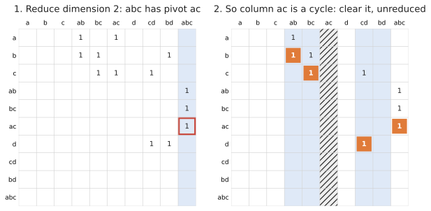
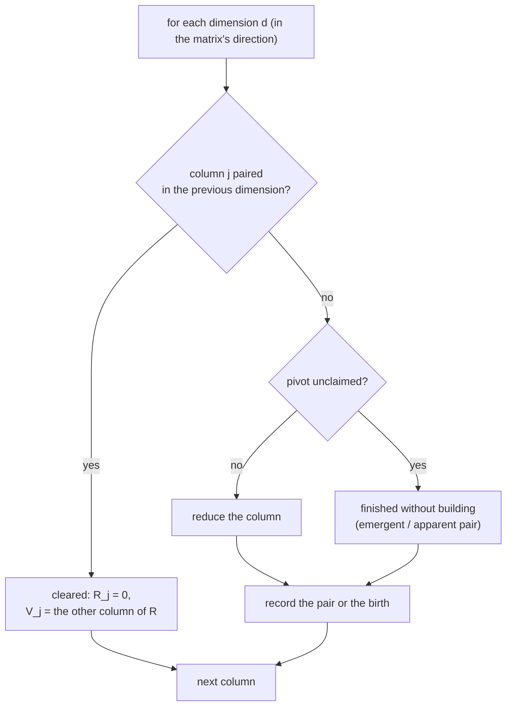

# Clearing

**Clearing** (Chen and Kerber's "twist") uses a fact about the pairs: if \\((i, j)\\) is a pair, then cell \\(i\\) gives
birth to a class, so column \\(i\\) of \\(R\\) will be **zero**. There is no need to reduce it.

So reduce the dimensions in the right order and every pair found in one dimension *clears* a column of the next:

Homology of the running example. Reducing dimension 2 pairs ac with abc, so column ac (hatched)
is set to zero without being reduced. Its reduction would have taken two additions.

`phlite::reduction::Clearing` does this dimension by dimension:

The **direction** is detected from the matrix: for a boundary matrix the pivots of dimension \\(d\\) lie in dimension
\\(d - 1\\), so dimensions are reduced from the top down; for a (reversed) coboundary from the bottom up. You can fix it
with `with_dimension_order`.

For representatives the cleared column still needs a \\(V\\) column; it is \\(R_j\\) of the column it was paired with,
which `phlite` keeps a reference to rather than copying (`ClearedReductionMatrix`).

## When it helps

- **Almost always.** It saves the reduction of every column that gives birth to a class which later dies, which is
  often the most expensive kind.
- **Most with cohomology**: the cleared columns are then the cells of the *higher* dimension, by far the most
  numerous (see [Homology or cohomology?](../background/cohomology.md)).

## When it doesn't

- It needs the column basis split by dimension (`HasSplitColBasis`).
- With homology the cleared columns are in the smaller dimension, so it saves less.
- The pairs of each dimension are kept until the next dimension is done, a little memory.

Clearing is also the framework the other tricks plug into: [apparent and emergent pairs](apparent-pairs.md),
[storing R](store-r.md) and the [parallel](parallel.md) version all build on it.
