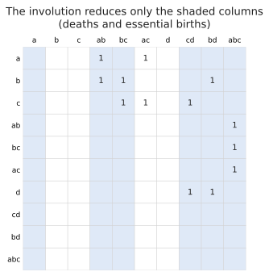

# Representatives and the involution

A **representative** of a bar is a cycle that is born at the bar's birth and (for a finite bar) becomes a boundary
exactly at its death.

## From homology: for free

Reducing the boundary matrix gives them directly:

- for a pair \\((b, d)\\), column \\(d\\) of \\(R = DV\\): a cycle with pivot \\(b\\) that is the boundary of
  \\(V_d\\), a chain present at \\(d\\);
- for an essential class born at \\(b\\), column \\(b\\) of \\(V\\): a cycle (\\(R_b = 0\\)) with leading term \\(b\\).

## From cohomology: the involution

Cohomology is usually [much faster](../background/cohomology.md), but its reduction gives *cocycles*. To get cycles,
`barcode::cohomology_with_involution` uses Čufar's *involuted persistence*:

1. Compute the **pairs** by cohomology, as fast as usual.
2. Run a **homology** reduction on the boundary matrix (the coboundary's transpose), but only of the columns that
   matter: the **death** cells of finite bars and the **birth** cells of essential bars.
3. Read representatives off that small reduction's \\(R\\) and \\(V\\), as above.

For the running example only six of ten columns are reduced: the deaths ab, bc, cd and abc, and
the essential births a and bd.

Why is that enough? Reducing a column only ever adds earlier columns that own a pivot, and every column that owns a
pivot is a death, so the death columns are closed under the reduction. Zero-length pairs are deaths too, and may be
missing from the diagram (they are [skipped](apparent-pairs.md#zero-length-apparent-pairs)), so this reduction keeps
apparent pairs switched on: their owners are recognised through the coboundary, without being in the basis.

## Costs and trade-offs

- **Good when** bars are few compared with cells, as is typical: the second reduction touches only the death columns,
  and nearly all of those are apparent pairs that need no work.
- **Costs** a homology reduction, which can be the slow direction, and needs the transpose (the boundary) to be
  available. On filtrations with very many bars (random point clouds in high dimension) it can cost as much as the
  cohomology itself.
- The reduction in step 2 uses a **restricted basis**, so it must *not* assume that every column is in the basis: in
  particular phlite_py's single-lookup pivot table (`full_basis`) is switched off for it (see
  [bookkeeping](../internals/bookkeeping.md#full-basis)). A bug where it wasn't was found by the fuzz tests.

Representatives in `phlite` are reported as lists of `(cell, coefficient)` in decreasing filtration order, so the
birth cell comes first.
