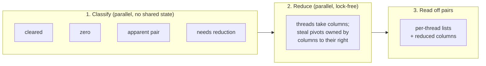

# Parallel clearing

`Clearing::new().parallel()` reduces each dimension on many threads, after Morozov and Nigmetov's lock-free
reduction (*Towards lockfree persistent homology*), organised much as in giotto-ph. It needs the `parallel` feature
(on in the Python packages).

## How it works

Dimensions are still done one after another (clearing needs the previous dimension's pairs), but within a dimension:

1. **Classify** every column in parallel: cleared, zero, apparent, or needing reduction. Results go into per-thread
   vectors, so this phase shares nothing. Typically only a small fraction of columns need reduction, and only they get
   any shared state.
2. **Reduce** those columns concurrently. A thread reduces a private copy of its column; when it meets a pivot owned
   by a column *to its right* (later in filtration order), it **publishes** its own column, **steals** the pivot, and
   carries on reducing the displaced column instead. Every column ends up owning a pivot or reduced to zero, and by
   the pairing uniqueness lemma the pairs are the same as the serial algorithm's.
3. **Read off** the pairs.

The pivot table is a concurrent map keyed by **row label**, never by row index, so the row space is never enumerated
(the main saving of cohomology survives). Published columns are snapshots of \\(V_j\\) with their pivot cached.

There are two storage backends:

| `storage` | Pivot table | Published columns | |
|---|---|---|---|
| `locking` (default) | `DashMap` (sharded read–write locks) | `Arc` behind a lock | robust, slightly faster on few threads |
| `lock-free` (feature `lock-free`) | `papaya` map, compare-and-swap | `ArcSwap` slots | no thread ever waits on another |

## When it helps

- **Large dimensions with many columns needing reduction**: GrPPH, Vietoris–Rips in dimension 2, large explicit
  complexes. The classify phase alone parallelises the expensive "is this column apparent?" checks.

## When it doesn't

- **Small inputs**: thread start-up and the concurrent maps cost more than they save.
- **When almost nothing needs reduction**: the work is then in classification, which serial clearing also does
  quickly.
- It doesn't support [storing R](store-r.md) or [pivot columns](../columns/pivot.md) (each column is reduced
  in a fresh working column), so for explicit cubical or dense complexes serial clearing with both is usually
  faster than parallel.
- Memory: each thread has its own working column, and published columns are kept as snapshots.

Use it with `Algorithm.parallel(threads)` in Python, or `Clearing::new().parallel().in_pool(&pool)` in Rust to run on
your own rayon pool.
