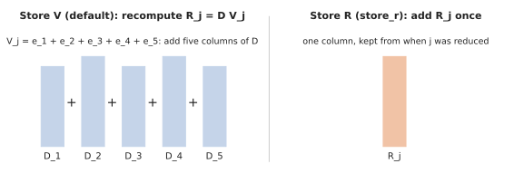

# Storing R, or recomputing it from V

When column \\(j\\) of \\(R\\) is needed to cancel a pivot, there are two ways to get it.

## Store V, recompute R (the default)

\\(V_j\\) is stored (sparse), and \\(R_j = D V_j\\) is rebuilt by adding the column of \\(D\\) for every term of \\(V_j\\).
This is what Ripser does.

- **Good when \\(V\\) stays short**: for Vietoris–Rips cohomology almost every pair is apparent, \\(V_j = e_j\\), and
  "recomputing" \\(R_j\\) is just generating one column of \\(D\\), which the oracle does cheaply.
- **Memory-light**: \\(V\\) is usually much sparser than \\(R\\), and the columns of \\(D\\) are never stored.
- **Bad when \\(V\\) gets long**: on dense matrices or cubical complexes a column of \\(V\\) can have hundreds of terms,
  and every use of \\(R_j\\) re-adds hundreds of columns of \\(D\\).

## Store R (`store_r`)

`Clearing::new().store_r(true)` keeps each reduced column \\(R_j\\) (from its pivot down) when it is first reduced, for
the rest of its dimension, and adds it as one column. This is what PHAT does.

- **Good when columns need many additions**: dense boundary matrices, cubical complexes, homology of cell complexes.
  On those it is several times faster.
- **Bad for memory** when \\(R\\) is much denser than \\(V\\).
- **No gain for Vietoris–Rips cohomology**, where almost nothing is reduced.

Apparent pairs and columns that needed no reduction are still never stored: their \\(R_j = D_j\\) comes straight from
the oracle.

## Not tracking V at all

When only the diagram is wanted (no representatives), and \\(R\\) is stored, nothing needs \\(V\\), so `Clearing`'s
`diagram()` doesn't track it. On dense matrices building \\(V\\) was most of the remaining work.

## Who uses what

| | default |
|---|---|
| `phlite` (Rust) | store V |
| `phlite_rips`, `phlite_grpph` | store V |
| `phlite` (Python, explicit complexes) | store R (serial clearing) |
