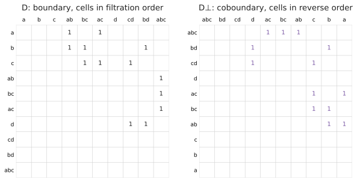

# Homology or cohomology?

There are two matrices you can reduce to get the same barcode.

- **Homology** reduces the boundary matrix \\(D\\): columns are cells, entries are their faces.
- **Cohomology** reduces the *coboundary* matrix: columns are cells, entries their *cofaces*. Put in the right order
  (both cells and cofaces in reverse filtration order) this is the **anti-transpose** \\(D^\perp\\) of \\(D\\).

The anti-transpose flips D about its anti-diagonal: rows and columns swap, and both are reversed.

The pairs of \\(D^\perp\\) are exactly the pairs of \\(D\\), with birth and death swapped (de Silva, Morozov and
Vejdemo-Johansson). So `phlite` reduces whichever is cheaper and reports bars in homology conventions either way.

## Why cohomology is usually faster

Ripser popularised cohomology because, combined with [clearing](../algorithms/clearing.md), it does far less work
on filtrations that grow quickly with dimension, like Vietoris–Rips:

- **Clearing works in the cheap direction.** With cohomology the dimensions are reduced from low to high, and the
  pairs found in dimension \\(d\\) clear columns of dimension \\(d + 1\\), the *larger* dimension, which has by far the
  most columns. With homology the pairs clear columns of the smaller dimension.
- **No need to enumerate the top dimension.** To compute \\(H_d\\) by cohomology you need columns only up to
  dimension \\(d\\); the cells of dimension \\(d + 1\\) appear only as *rows*, produced lazily as cofaces. Homology needs
  every \\((d+1)\\)-cell as a column. For Rips in dimension 2 that is the difference between enumerating the triangles
  and enumerating the tetrahedra.
- **Apparent pairs are found from the cheap end.** Most columns of a Rips coboundary are finished by
  [emergent pairs](../algorithms/apparent-pairs.md) without being built.

## When homology is better

- **When you want representatives cheaply.** Homology gives cycle representatives directly (columns of \\(R\\) and
  \\(V\\)). Cohomology gives *cocycles*; `phlite` gets cycles from a cohomology computation with a second, much
  smaller reduction, [the involution](../algorithms/involution.md), which costs extra.
- **When columns of the boundary are short and the complex is not much bigger in the next dimension.** For explicit
  cell complexes and some cubical complexes the two are close; in the benchmarks homology was about 7% faster on a
  cubical complex of random noise, but slower on the others, and about 3× slower on random cell complexes.
- **For relative cohomology** you can reduce \\(D\\) in the other direction: `phlite`'s
  [`reverse`](../design/oracles.md#adaptors) adaptor gives the anti-transpose of any matrix.

Every barcode function and Python package takes a `method` (`"cohomology"` by default, or `"homology"`).
