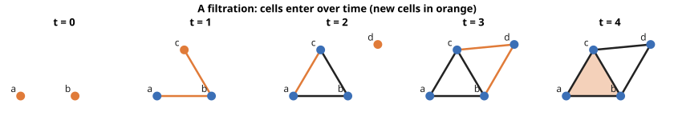
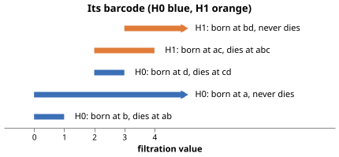
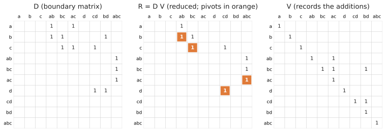
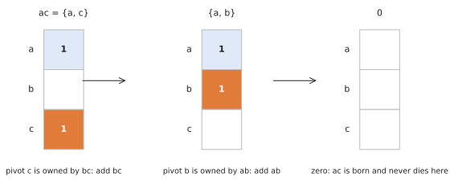

# Persistent homology in one chapter

This chapter recaps just enough persistent homology to follow the algorithms, through one running example. For a
proper introduction see Edelsbrunner and Harer's *Computational Topology*, or Otter et al.'s *A roadmap for the
computation of persistent homology* (see [references](../appendix/references.md)).

## Filtrations

A **filtered chain complex** is a chain complex whose cells appear one at a time. Each cell has a **filtration value**
(the time it appears), and every face of a cell must appear no later than the cell itself. Here is the running
example: four vertices, five edges and a triangle.

The running example. At t = 4 the triangle abc fills in the loop a–b–c.

Listing the cells by filtration value (breaking ties by a fixed order), we get a **filtration order**:

| index | 0 | 1 | 2 | 3 | 4 | 5 | 6 | 7 | 8 | 9 |
|---|---|---|---|---|---|---|---|---|---|---|
| cell | a | b | c | ab | bc | ac | d | cd | bd | abc |
| value | 0 | 0 | 1 | 1 | 1 | 2 | 2 | 3 | 3 | 4 |

## Persistence

As cells appear, homology classes (connected components in dimension 0, loops in dimension 1, voids in dimension 2,
...) are **born** and later **die**. Each class gives a **bar** from its birth to its death: the **barcode**.

The barcode: two components and a loop die; one component and one loop never do.

Reading it off the filtration:
- `a` and `b` are born at 0; the edge `ab` merges them at 1, so one of the two components dies (by convention the
  younger one, `b`).
- `c` is born at 1 and dies at 1, when `bc` joins it to the rest: a bar of **length zero**, which is not drawn.
- `ac` closes the loop a–b–c at 2; the triangle `abc` fills it at 4.
- `d` is born at 2 and dies at 3.
- `bd` closes another loop at 3 (b–c–d), which nothing ever fills: an **essential** (infinite) bar.

## Persistence by matrix reduction

The **boundary matrix** \\(D\\) has a column and a row for every cell, in filtration order; column \\(j\\) holds the
faces of cell \\(j\\). Over \\(\mathbb{Z}/2\\) the entries are just 0 and 1.

The **pivot** (or *low*) of a column is its last non-zero entry: the face that appeared most recently. We reduce \\(D\\)
by adding columns left to right until **no two columns share a pivot**, recording the additions in \\(V\\), so that

\\[ R = D V \\]

with \\(V\\) upper triangular. Then the pairing can be read straight off \\(R\\):

- if column \\(j\\) of \\(R\\) has pivot \\(i\\), the class born at cell \\(i\\) **dies** at cell \\(j\\): a pair \\((i, j)\\);
- if column \\(j\\) of \\(R\\) is zero, cell \\(j\\) **gives birth** to a class; if no column has pivot \\(j\\), that class
  never dies (it is **essential**).

D, its reduction R = DV (pivots in orange) and V. The pairs are (b, ab), (c, bc), (d, cd) and (ac, abc).

Different reductions give different \\(R\\) and \\(V\\), but always the **same pairs** (the *pairing uniqueness lemma*).
That is what lets `phlite` choose freely between algorithms, column representations and orders of work: they all
give the same barcode.

Columns of \\(R\\) and \\(V\\) are also **representatives**: for a pair \\((i, j)\\), column \\(j\\) of \\(R\\) is a cycle
born at \\(i\\) that becomes a boundary at \\(j\\); for an essential class born at \\(i\\), column \\(i\\) of \\(V\\) is a
cycle born at \\(i\\).

## Reducing a column

Reducing one column means repeatedly finding its pivot and, if an earlier column owns the same pivot, adding that
column. Here is column `ac`:

Reducing ac: two additions, after which it is zero, so ac gives birth to a loop.

Every algorithm in `phlite` is built from these two operations: *pop the pivot* and *add a column*. How they are done
is the subject of the [column representations](../columns/overview.md); which columns get reduced, and in what
order, is the subject of the [reduction algorithms](../algorithms/standard.md).

## Representing a filtration in phlite

`phlite` doesn't need you to number your cells or store \\(D\\). Cells can be labelled by any type (a simplex packed
into an integer, a path in a digraph, a pair of pixel coordinates), and the filtration order is the order on
`(filtration value, label)`. Columns are produced on demand by your [oracle](../design/oracles.md).
