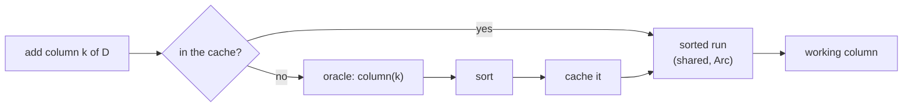

# Caching columns

Separately from the representation, an algorithm can keep each **column of \\(D\\)** the first time it is added,
sorted, in a `ColumnCache` shared by every column of that dimension (`cache_columns`). Later additions of the same
column then neither recompute nor re-sort it.

The cache is a concurrent map (`DashMap`), so the parallel algorithm shares it between threads, and it is cleared at
the end of each dimension (columns are only ever added within their dimension).

## Good

- **When columns are expensive to compute**: on GrPPH, whose coboundary enumerates the path cofaces of a digraph,
  caching makes merged columns about 3× faster. It is on by default in `phlite_grpph` and the Rust library.

## Bad

- **When columns are cheap**: the cache holds every column needed in a dimension until the dimension is done, which
  for Vietoris–Rips is most of the memory the reduction uses (23 MB rather than 5 MB for 400 points), and looking a
  column up costs about as much as recomputing it. Off in `phlite_rips`.
- **When the matrix stores its columns sorted** (`sorted_column`, as for explicit complexes): columns are then never
  sorted, only copied, and the cache saves just that copy. That helps when columns are long (about 10% on cell
  complexes) and costs a little when they are short (about 20% on cubical complexes). Off in the `phlite` Python
  package.
