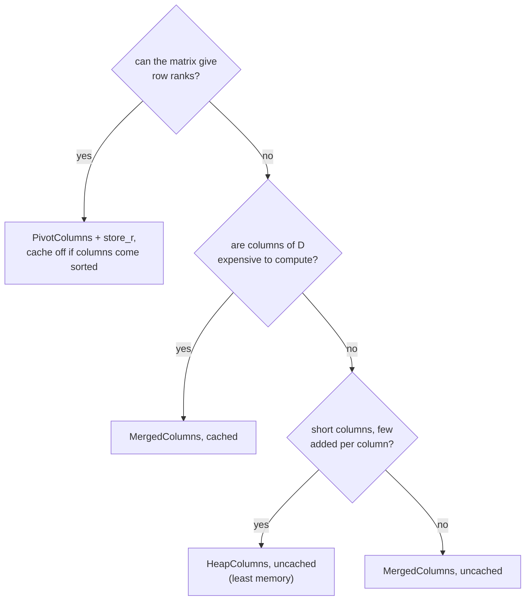

# Choosing a representation

Start with the defaults: each package picks the one that won its benchmarks. If you are writing your own oracle:

| Matrix | Best | Package default |
|---|---|---|
| Vietoris–Rips cohomology | heap or merged, uncached | `phlite_rips`: heap, uncached |
| GrPPH cohomology | merged, cached | `phlite_grpph`: merged, cached |
| explicit cubical / dense / cell complexes | pivot, store R, uncached | `phlite`: pivot, store R, uncached |
| homology of small simplicial complexes | sorted | |

All combinations are compared in the [benchmarks](../appendix/benchmarks.md), and every combination is checked to
give the same barcode by the [tests](../appendix/testing.md).
