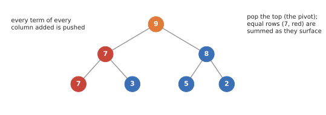

# Heap columns

`HeapColumns` pushes **every term of every column added** onto one heap (`BHCol`), and pops from the top, summing
terms with the same row as they surface. This is the classic approach, and what Ripser does.

The heap holds every term added, including both copies of row 7, which cancel when they reach the top.

`phlite` uses a **4-ary heap**: half the depth of a binary heap, with each node's children next to each other in
memory, which matters once the heap outgrows the cache (an 8-ary heap was slower).

## Good

- **No sorting at all.** Columns of \\(D\\) go in as the oracle produces them.
- **Little memory** when few, short columns are added: just the terms.
- On **Vietoris–Rips cohomology**, where columns are short and few are added per column, it matches merged columns
  with less memory, which is why it is `phlite_rips`' default.

## Bad

- **Many terms added**: the heap holds every term, cancelled or not, including all those far below the eventual pivot.
  Each push and pop costs \\(O(\log n)\\) in the heap's size, and once it outgrows the cache every operation slows down.
- So it is slow for GrPPH, cubical complexes and dense matrices (3–4× slower than merged columns on GrPPH).
