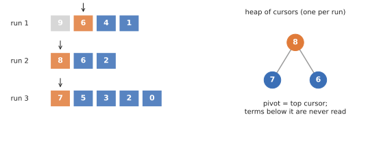

# Merged columns

`MergedColumns` (the default in the Rust library and `phlite_grpph`) **never builds the working column**. It keeps the
columns added so far, each **sorted largest first** (a `SortedRun`), and a small heap of **cursors**, one per column.

Three runs (columns of D added so far) and a heap of their current heads. Run 1's head (9)
cancelled and was skipped; the pivot is now the top cursor, 8.

- **Add a column**: push one cursor pointing at its head.
- **Pop the pivot**: take the largest cursor, sum in any other cursors on the same row, and advance them all.

## Good

- **Nothing below the pivot is ever read.** When columns are long and the reduction stops near the top, almost all of
  each column is skipped.
- **The heap has one slot per column added, not per term**, so it stays small and in cache.
- It is the only representation that does well on every kind of matrix we have tried, hence the default. On GrPPH it
  is 3–4× faster than heap columns.

## Bad

- **Every column of \\(D\\) must be sorted** before it is added. Matrices that can produce their columns already sorted
  should say so with `sorted_column`, and the [cache](caching.md) can keep sorted columns for reuse.
- Each step of the pivot search is a heap operation, which costs more than flipping a bit
  ([pivot columns](pivot.md)) when columns are dense.
