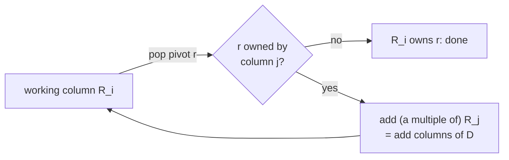

# The working column

Whatever the algorithm, reducing a column means repeating two operations on a **working column** \\(R_i = D V_i\\):

- **pop the pivot**: find its largest entry (summing entries with the same row, and moving on when they cancel);
- **add a column**: add a multiple of a column of \\(D\\) (or a stored column of \\(R\\)) to it.



How the working column is stored is its **representation**, a type implementing `ColumnRepresentation`, chosen
with `with_columns` on any algorithm:

```rust,ignore
Clearing::new().with_columns(PivotColumns)
```

Every representation gives the same pairs; only the time and memory differ. The difference can be large: on some
inputs the best is 30× faster than the worst. There are four:

| Representation | Idea | Analogue |
|---|---|---|
| [`HeapColumns`](heap.md) | every term on one heap | Ripser |
| [`MergedColumns`](merged.md) (default) | lazily merge sorted columns, one heap slot per column | |
| [`SortedColumns`](sorted.md) | one sorted vector, batches merged in | PHAT's `vector_vector` |
| [`PivotColumns`](pivot.md) | a dense array over all rows, plus a bit tree | PHAT's `bit_tree_pivot_column` |

Separately, a [column cache](caching.md) can keep the columns of \\(D\\) that get added, sorted, so they are neither
recomputed nor re-sorted. [Choosing](choosing.md) summarises when each wins.
