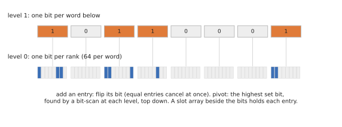

# Pivot columns

`PivotColumns` is PHAT's `bit_tree_pivot_column`: the working column is a **dense array with a slot for every row**,
plus a **64-ary tree of bitsets** saying which slots are in use.

Level 0 has a bit per row (by rank); each bit of level 1 says whether a word of level 0 is non-zero.
Three levels cover 262,144 rows, four cover 16 million.

- **Add an entry**: write it into its slot and **flip its bit**. Over Z/2 equal entries cancel at once, by the flip.
  The upper levels only change when a word becomes empty or non-empty.
- **Pop the pivot**: the highest set bit, found by one bit-scan (a single instruction) per level, from the top down.

This needs the **rank** of every row in filtration order, so a matrix provides it with `row_ranks`; for matrices that
don't, pivot columns fall back to merged columns. (The Python bindings refuse `'pivot'` there rather than silently
merging.)

## Making it fast

Profiling turned up three things worth knowing, all specific to Z/2:

- **Branchless flips.** "Is this row already present?" is a coin toss on dense columns, which the CPU mispredicts
  constantly. Since a field with one non-zero element is Z/2, `phlite` detects it at compile time (the coefficient type
  is zero-sized) and flips the bit unconditionally, writing the slot whether or not the entry ends up present. That cut
  dense 400 × 400 matrices from 28 ms to 11 ms.
- **Flipping a word at a time.** Entries arrive sorted, so neighbours share a 64-bit word; gathering their flips and
  applying them together avoids each flip waiting on the last one's write (dense: 8.8 → 7.3 ms).
- **No rank lookups.** When rows are already numbered by rank (as for [explicit complexes](../internals/explicit.md)),
  `RowRanks::identity` skips the table entirely.

## Good

- **Many columns added to each**, as for explicit dense or cubical complexes, especially with [stored R](../algorithms/store-r.md):
  1.4–5× faster than merged columns there, and the default for explicit complexes in the Python `phlite` package.

## Bad

- **Every entry added is visited**: nothing below the pivot is skipped, unlike merged columns.
- **A slot for every row**, allocated once per reduction: fine for explicit complexes, impossible for Vietoris–Rips
  (where rows are simplices labelled by huge sparse indices).
- **Only serial clearing** reuses one working column; the standard and parallel algorithms make a fresh column per
  column, and use merged columns instead.
