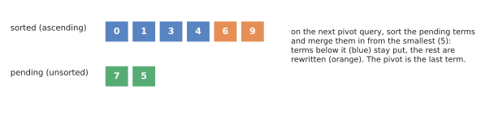

# Sorted columns

`SortedColumns` keeps the working column as **one vector, sorted ascending**, so the pivot is the last entry.
Columns added are collected unsorted; at the next pivot query they are sorted together (they are usually few and
short) and merged in, starting from their smallest entry: everything below that stays where it is.

The merge works by position over two slices, which compiles to a tight loop. (An earlier version merged through
iterator adaptors and kept its state in memory, which made it twice as slow; the benchmarks caught it.)

## Good

- **When the columns added stay close to the pivot**, so each merge only rewrites the top of the vector: typical of
  *homology* of simplicial and cell complexes, where it is the fastest representation (about 1.5× faster than merged
  columns on Rips homology), and of small dense matrices.

## Bad, sometimes very bad

- **When the columns added reach far below the pivot**: each addition then rewrites nearly the whole working column, so
  the cost grows with its length. On GrPPH and on the cohomology of cubical complexes it is 15–35× slower than merged
  columns, and on structured Vietoris–Rips it can take hours where the others take seconds.

Only use it after measuring it on your matrices.
