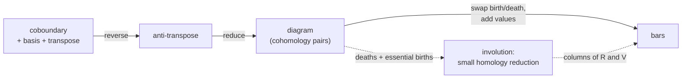

# From a matrix to a barcode

There are two levels of API.

## Low level: `reduction`

Each algorithm is a value implementing `ReductionAlgorithm`. Configure it, then call `reduce` (giving \\(V\\) and
the diagram) or `diagram` (just the pairs, which can be much cheaper):

```rust,ignore
use phlite::reduction::{Clearing, ReductionAlgorithm};
use phlite::columns::HeapColumns;

let reduction = Clearing::new()
    .with_columns(HeapColumns)   // how to represent the column being reduced
    .cache_columns(false)        // don't keep columns of D
    .reduce(&matrix);
// reduction.v: an oracle for V; reduction.diagram: (birth, death) pairs and essential columns
```

| Algorithm | Notes |
|---|---|
| [`Standard`](../algorithms/standard.md) | reduces every column, in order |
| [`Clearing`](../algorithms/clearing.md) | dimension by dimension, clearing; apparent and emergent pairs; optionally storing R |
| [`ParallelClearing`](../algorithms/parallel.md) | clearing with each dimension reduced on many threads (`Clearing::new().parallel()`) |

The diagram is in terms of *columns of the matrix you reduced*. If you reduced a reversed coboundary, the labels are
wrapped in `Reverse`, and births and deaths are swapped relative to homology.

## High level: `barcode`

`phlite::barcode` turns a matrix into `Bar`s in homology conventions, with filtration values, and optionally a
representative cycle for each:

```rust,ignore
use phlite::barcode::{self, Algorithm};

// Homology: reduce the boundary matrix (with its basis and, ideally, its transpose)
let bars = barcode::homology(boundary, Algorithm::default(), /* representatives */ true);

// Cohomology: reduce the (anti-transposed) coboundary, usually much faster
let bars = barcode::cohomology(coboundary, Algorithm::default());

// Cohomology with cycle representatives, via the involution (needs the transpose attached)
let bars = barcode::cohomology_with_involution(coboundary, Algorithm::default());
```



`Algorithm` wraps the three algorithms (`Algorithm::Standard(..)`, `Algorithm::Clearing(..)`,
`Algorithm::ParallelClearing(..)`), so a caller can pick one at run time.

Bars of length zero are omitted: in most filtrations there are far more of them than of anything else, and they carry
no information. The clearing algorithms avoid even recording most of them (see
[skipping zero-length apparent pairs](../algorithms/apparent-pairs.md#zero-length-apparent-pairs)).
