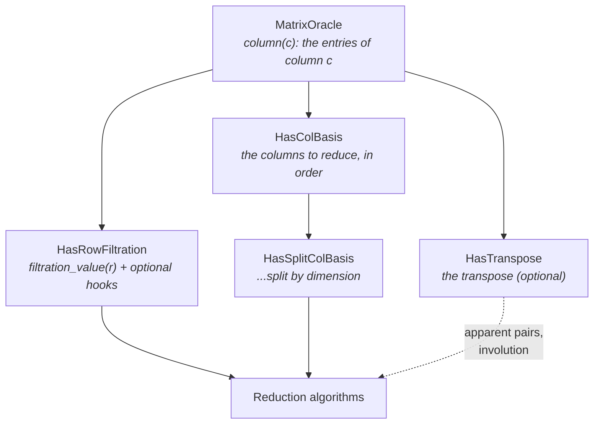

# Matrix oracles

`phlite`'s central abstraction is the **matrix oracle**: a matrix you can ask for one column at a time, which need not
be stored anywhere. The traits are in `phlite::matrices`, and layer up like this:



## `MatrixOracle`: the columns

```rust,ignore
pub trait MatrixOracle {
    type CoefficientField: NonZeroCoefficient; // e.g. Z2, or ZP<3>
    type ColT: BasisElement;                  // labels of columns
    type RowT: BasisElement;                  // labels of rows

    fn column(&self, col: Self::ColT) -> impl Iterator<Item = (Self::CoefficientField, Self::RowT)>;
}
```

That is the only required method. Labels can be any type that is `Ord + Clone` (and marked as a
[`BasisElement`](#basiselement-labels)): Ripser-style packed simplex indices, paths in a digraph, coordinates. The
order on labels breaks ties between cells with the same filtration value.

**Why an iterator?** So that columns are produced lazily, in whatever order is convenient, and never stored. The
algorithms consume them with internal iteration (`for_each`), so chained and flattened iterators cost nothing.

**Coefficients** are a type, not a runtime value: `Z2` is zero-sized, so a column over Z/2 is just its row labels and
the arithmetic compiles away. `ZP<P>` covers small primes.

## `HasRowFiltration`: the order

```rust,ignore
pub trait HasRowFiltration: MatrixOracle {
    type FiltrationT: FiltrationValue; // Ord + Clone, e.g. NotNan<f64>
    fn filtration_value(&self, row: Self::RowT) -> Self::FiltrationT;
    // ... and optional hooks, below
}
```

Entries are ordered by `(filtration value, row label)`, and the **pivot** of a column is its largest entry. If you
have no filtration (plain homology) use `with_trivial_filtration()`; if the filtration is a function, attach it with
`with_filtration(f)`.

### The optional hooks

Each has a correct default; overriding it unlocks an optimisation.

| Hook | Default | Override it to... |
|---|---|---|
| `column_with_filtration` | `column` + `filtration_value` per entry | compute a column's filtration values together |
| `column_pivot` / `column_min` | scan the whole column | find the pivot without visiting every entry ([emergent pairs](../algorithms/apparent-pairs.md#emergent-pairs)) |
| `sorted_column` | `None` | hand over columns already sorted, so they aren't sorted again ([merged columns](../columns/merged.md)) |
| `first_column_in_row` / `last_column_in_row` | `None` | recognise [apparent pairs](../algorithms/apparent-pairs.md) |
| `row_ranks` | `None` | give each row's position in filtration order, for [pivot columns](../columns/pivot.md) |
| `same_filtration_value` | compare `filtration_value`s | compare the real values when `FiltrationT` is finer than the filtration ([explicit complexes](../internals/explicit.md)) |

## `HasColBasis` and `HasSplitColBasis`: which columns

The matrix says what each column *is*; the **basis** says which columns to reduce, and in which order (filtration
order). Clearing needs it split by dimension. The usual way is to build a `SplitBasis` (one vector of labels, plus
the offset where each dimension starts) and attach it:

```rust,ignore
let basis = SplitBasis::from_dimensions([vertices, edges, triangles]); // each sorted by filtration
let d = my_boundary.with_basis(basis);
```

You only need a basis for the *columns*. Rows are produced by the oracle and never enumerated, which is why
cohomology never builds the top-dimensional cells (see [Homology or cohomology?](../background/cohomology.md)).

A basis may also leave cells out: the clearing algorithms don't need the cells of zero-length
[apparent pairs](../algorithms/apparent-pairs.md#leaving-them-out-of-the-basis), which for Vietoris–Rips is nearly
all of them.

## `HasTranspose`

Attach the transpose with `with_transpose(t)` (for a coboundary, the boundary, and vice versa). It provides
`first_column_in_row` and `last_column_in_row` (the pivot and minimum of the transpose's column), which is what
[apparent pairs](../algorithms/apparent-pairs.md) need, and it is what the [involution](../algorithms/involution.md)
reduces to compute representatives from cohomology.

## `BasisElement`: labels

```rust,ignore
pub trait BasisElement: Ord + Clone {
    const DENSE_INDEX: bool = false;
    fn dense_index(&self) -> usize { unimplemented!() }
    fn from_dense_index(index: usize) -> Self { unimplemented!() }
}
```

If your labels are (or map injectively to) small integers, set `DENSE_INDEX` and the reduction's
[bookkeeping](../internals/bookkeeping.md) uses plain vectors instead of hash maps. The choice is a constant, so the
other branch compiles away.

## Adaptors

Methods on `MatrixOracle` wrap a matrix to add or change something, without copying it:

| Adaptor | Gives |
|---|---|
| `with_filtration(f)`, `with_trivial_filtration()` | a `HasRowFiltration` |
| `with_basis(b)` | a `HasColBasis` (and `HasSplitColBasis` for a `SplitBasis`) |
| `with_transpose(t)` | a `HasTranspose`, and apparent pairs |
| `reverse()` | the **anti-transpose**: the order on rows and columns reversed (labels wrapped in `Reverse`) |
| `consolidate()` | columns with repeated rows summed |
| `using_col_basis_index()` | columns labelled by their position in the basis |
| `combinators::product(a, b)` | the product of two oracles (e.g. `R = D V`) |

Adaptors forward the optional hooks where that makes sense; `reverse` swaps the "first/last" and "pivot/min" ones,
so a coboundary that knows its smallest entry is fast after reversing too.

Wrappers also work on references (`&M` is a matrix if `M` is), so you can keep the original and reduce a view of it.
