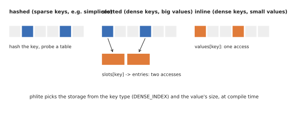
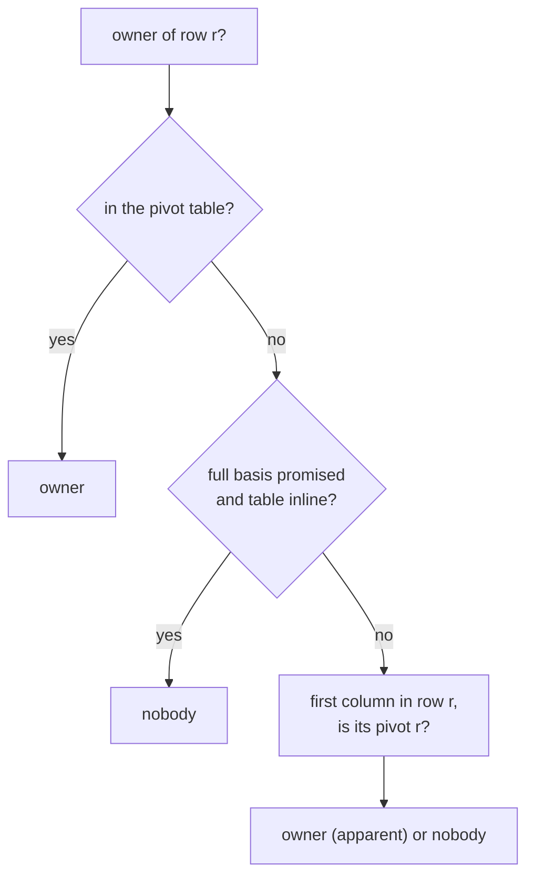

# Bookkeeping: pivot tables and maps

Besides the working column, the clearing algorithm keeps per-column state, all keyed by cell labels:

| Map | Key → value | Used for |
|---|---|---|
| pivot table (`low_inverse`) | pivot row → owner column (and pivot coefficient) | "who owns this pivot?", on every addition |
| previous pairs | row → column | clearing the next dimension |
| reduction columns | column → \\(V_j\\) | adding \\(R_j = D V_j\\), representatives |
| stored R | (a vector, indexed from the pivot table) | [storing R](../algorithms/store-r.md) |
| essential, skipped births | column | the diagram |

## `ElementMap`: three storages

`phlite::bookkeeping::ElementMap` chooses its storage from the key type and the value's size, at compile time:

- **Hashed** (`FxHashMap`): for labels without [dense indices](../design/oracles.md#basiselement-labels), such as
  simplices packed into 64-bit integers. Memory proportional to the entries.
- **Slotted**: for dense labels with large values. A vector of 4-byte slots indexed by the label, pointing into a
  vector of entries: two memory accesses per lookup, 4 bytes per possible label.
- **Inline**: for dense labels with values of at most 8 bytes (with their `Option` tag), such as a pivot table over
  Z/2. The values live in the indexed vector itself: **one** memory access per lookup.

On large explicit complexes the reduction is limited by memory latency (see
[where the time goes](performance.md)), so one access instead of two is a real saving.

## The owner of a pivot

Finding the column that owns a pivot is the reduction's most frequent question. The pivot table stores an `Owner`,
which is either the owning column (whose \\(R\\) is a column of \\(D\\), or recomputed from \\(V\\)) or the position of
its stored column of \\(R\\), so that adding a stored column is one lookup, not two. Over Z/2 with 4-byte labels the
whole entry (with its `Option` tag) fits in 8 bytes, so the table is inline; a unit test guards that layout.

## Full basis

Normally [apparent pairs](../algorithms/apparent-pairs.md) are not stored in the pivot table, and an owner not found
there is recomputed through the transpose (two dependent lookups in the transpose and two in the matrix).

When the table is inline it has a slot for every row anyway, so storing apparent pairs too is free, and then the table
alone answers "who owns this pivot?" in one access. But that is only correct if **every column of the dimension is in
the basis**: an apparent pair whose column isn't visited is never recorded. So it is an explicit promise,
`Clearing::full_basis(true)`, which phlite_py makes (its basis is every cell up to some dimension) and the
[involution](../algorithms/involution.md), whose basis is restricted, must not.

