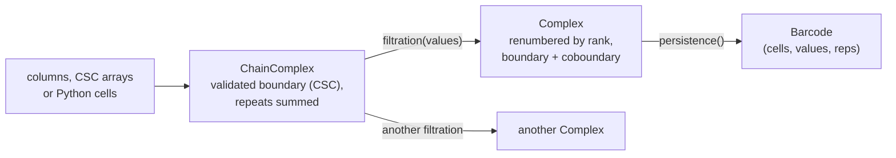
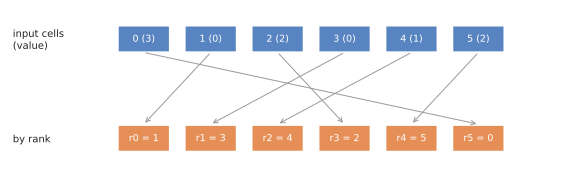

# Explicit complexes (phlite_py)

The `phlite` Python package reduces complexes you give it explicitly, like PHAT and LoPHAT. Under the hood it is an
ordinary `phlite` oracle over stored matrices, but laid out so that the reduction runs at PHAT's speed.

## Two stages

- A **`ChainComplex`** is the boundary matrix in compressed sparse column (CSC) format with `u32` cell indices,
  validated (faces one dimension down) and with repeated entries summed. It has no filtration, so one chain complex can
  be given many.
- **`filtration(values)`** builds a `Complex`: it checks every face enters no later than its cofaces, then lays the
  matrices out for the reduction.

## Renumbering by rank

The reduction visits cells in filtration order, and looks up rows by their position in that order. If cells kept their
input numbering, every lookup would jump around memory. So a `Complex` **renumbers every cell by its rank**, its
position in the order on `(value, index)`:

Input cells with values; renumbered by rank (ties broken by index). Results are translated back.

That buys four things:

- **The rank is the filtration value.** Comparing ranks orders entries exactly as comparing `(value, index)` does, so
  the views use the rank itself (a `u32`) as `FiltrationT`. The reduction never reads a real value: one random memory
  access per entry saved, and entries half the size.
- **Rows are their own ranks**, so [pivot columns](../columns/pivot.md) need no rank table (`RowRanks::identity`).
- **Columns are sorted by rank**: each column is stored in decreasing rank order, so the pivot is the first entry and
  the smallest the last (`column_pivot`, `column_min` and `sorted_column` are O(1) or free).
- **Dense labels**: `Cell` sets `DENSE_INDEX`, so all bookkeeping is in vectors, mostly [inline](bookkeeping.md).

Since ranks are finer than values, "are these two cells at the same value?" (for skipping zero-length pairs) needs the
real values: a `Complex` keeps, for each rank, where its run of equal values starts (`tie_start`), so the check reads
only the later cell, which in a reduction is the column being reduced, in order.

It also stores the **transpose** (the coboundary), sorted the same way, which gives apparent pairs in O(1) and the
involution for representatives.

## Results

Bars come out of the reduction in rank space and are turned into records with input cells, values and dimensions in
one pass (a cell's value, input index and dimension sit together, 16 bytes per rank, so translating a bar reads one
place). Records are small `Copy` structs, sorted by birth cell with a radix sort. Python objects are only created when
you access the bars.

## Memory

Per filtered complex: about **8 bytes per non-zero entry** (4 in each of the boundary and coboundary) and **36 bytes
per cell** (column pointers for both matrices, the rank tables and the values), with at most 2³² − 2 entries. The
inputs are validated once, in the `ChainComplex`.
