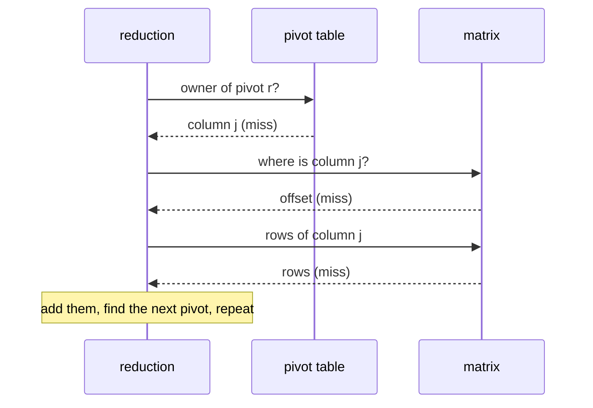

# Where the time goes

Two very different regimes show up in practice.

## Compute-bound: Rips and GrPPH

For Vietoris–Rips and GrPPH the cost is in **producing columns**: enumerating cofacets, computing diameters or path
lengths, comparing labels. The optimisations that matter are the ones that avoid building columns at all
([apparent and emergent pairs](../algorithms/apparent-pairs.md), [clearing](../algorithms/clearing.md), leaving
zero-length pairs out of the basis) and cheap label arithmetic (Rips packs a simplex into one integer and computes its
cofacets by inserting a digit; GrPPH compares paths through a packed 128-bit key).

## Latency-bound: large explicit complexes

A 1000 × 1000 image (4 million cells) has surprisingly little *work*: about 2 million columns to look at, 94 thousand
that need reducing, and about a million column additions. Its working set (matrices, pivot table, working column) is
hundreds of megabytes, far beyond the CPU cache, and each step of the reduction is a chain of **dependent random
memory accesses**: find the pivot, look up its owner, find the owner's column, read its rows. Each miss costs on the
order of 100 ns.



In this regime the number of misses per step is everything, and generality costs misses: a rank lookup, a filtration
value lookup, a two-level map, recomputing an apparent owner through the transpose. Before it was tuned, `phlite` made
four or five dependent misses per pivot lookup where PHAT makes one, and was 2× slower on such grids. Closing the gap
meant letting explicit complexes *declare* PHAT-like structure through opt-in hooks:

| Change | Grid 1000 × 1000 (Rust) |
|---|---|
| starting point | 770 ms |
| renumber cells by rank (no change on its own: the misses moved elsewhere) | 779 ms |
| use the rank as the filtration value | 758 ms |
| inline maps, apparent pairs in the pivot table (`full_basis`) | 628 ms |
| identity row ranks (no table lookup) | 505 ms |
| stored R found from the pivot table | 463 ms |
| zero-length checks in order, basis in one pass | 442 ms |
| `u32` column pointers | 435 ms |

PHAT takes about 400 ms on the same matrix. What remains is mostly `phlite` doing more: it keeps the transpose too
(for apparent pairs, cohomology and representatives), translates results back to your cells with values, and drops
zero-length bars. On rings images and meshes it is now level with PHAT to within about 10%; on dense matrices and
sparse cell complexes it is level or faster.

## Measuring

`phlite_py/examples/reduce_file.rs` reduces a complex dumped from the benchmark cache, in pure Rust, so you can profile
without Python:

```sh
RUSTFLAGS="-C force-frame-pointers=yes" cargo build --release -p phlite_py --example reduce_file
perf record -g target/release/examples/reduce_file grid1000.bin 5
```

`perf stat -e cycles,instructions,LLC-load-misses` quickly tells you which regime you are in.
