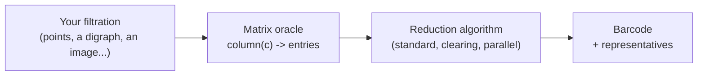

# Introduction

`phlite` computes **persistent homology**. It is a set of Python packages for point clouds, networks, images and
chain complexes of your own; underneath, a Rust library in which the same reduction algorithms run on *any* filtration
you can describe, as a matrix whose columns are computed on demand rather than stored.

This book serves three kinds of reader. Pick the one that sounds like you.

## Where to start

### "I want persistent homology of my data, from Python"

```sh
pip install phlite
```

```python
from phlite.clouds import rips

barcode = rips(points=X, max_dim=1)    # X: an (n, d) numpy array
barcode.pairings[1]                    # (birth, death) of the finite H1 bars
```

Find your input below, then read its chapter: each says what it computes, how it compares with the library you might
know, and how it was checked.

| Your data | Functions | Chapter |
|---|---|---|
| Points or a distance matrix | `rips` (dense, sparse, thresholded), weighted and DTM-Rips, `alpha`, `delaunay_cech` | [`phlite.clouds`](python/clouds.md) |
| A weighted digraph (networkx or an edge list) | `pph`, `grpph`, `directed_flag` (as flagser), `ordered_tuples`, `dowker` | [`phlite.networks`](python/networks.md) |
| An image or volume (a numpy array) | `cubical`, T- or V-construction, sublevel or superlevel sets | [`phlite.images`](python/images.md) |
| A complex you build yourself (any cells, any filtration) | `ChainComplex`, `FilteredComplex.persistence`: a drop-in for PHAT or LoPHAT | [`phlite.complexes`](python/complexes.md) |

Then, as you need them:

- [The Python packages](python/index.md): what every function shares (representatives, homology or cohomology, the
  `Algorithm` argument), and how the packages fit together.
- [Choosing an algorithm](python/algorithms.md): serial or parallel, and each pipeline's tuned defaults. You can ignore
  this: the defaults are the fastest we measured.
- [Example notebooks](python/notebooks.md) and the [API reference](../api/index.html) (every argument of every function).
- The **[playground](../playground/)** runs all of this in your browser (on all your cores, nothing to install), with
  barcodes and representatives drawn on the data.

### "I want persistent homology of my own filtration, in Rust"

You describe your filtration as a matrix *oracle* (a function from a column's label to that column's entries) and
`phlite` reduces it, with as many of Ripser's optimisations as your filtration allows. Add `phlite` from
[crates.io](https://crates.io/crates/phlite) ([API docs](https://docs.rs/phlite/latest/phlite/)), or from the
[repository](https://github.com/tomchaplin/phlite) for the latest, then read:

1. [Matrix oracles](design/oracles.md) and [From a matrix to a barcode](design/barcodes.md): the traits you implement
   and what you get back.
2. The **[tutorial](tutorial/index.md)**: persistent homology of a filtration `phlite` has never seen (a 3D volume's
   cubical complex), built up in seven steps, each unlocking an optimisation, with timings. Its first page also says
   when a lazy oracle is the right tool, and when to build the complex explicitly instead.
3. [Choosing a column representation](columns/choosing.md), once it works and you want it faster.

The crates that ship with `phlite` are worked examples: `phlite_clouds::rips` (Vietoris–Rips with Ripser's tricks),
`phlite_images::cubical` (a cubical oracle, with union-find at both ends) and `phlite_networks::lazy`, a reusable
framework for any complex you can describe by listing a simplex's cofacets in order (it gives you the coboundary and
boundary oracles, apparent and emergent pairs included).

### "I want to understand how phlite works"

Read the book in order. [Background](background/persistence.md) recaps persistent homology as matrix reduction on one
small example that every later chapter comes back to; [How phlite is built](design/oracles.md) explains the oracle
traits; the chapters on [reduction algorithms](algorithms/standard.md) and
[column representations](columns/overview.md) explain every algorithm and trick (how it works, why it helps, and when
it doesn't); and [Inside phlite](internals/bookkeeping.md) covers the lower-level engineering and
[where the time goes](internals/performance.md). The appendix says how everything is
[tested](appendix/testing.md) and [benchmarked](appendix/benchmarks.md).

## The idea: matrices you never store

Every persistent homology computation boils down to reducing a big sparse matrix: the boundary matrix of the
filtration, or its transpose. Most libraries (PHAT, LoPHAT, Dionysus, GUDHI's matrix reductions, ...) want that
matrix *stored*, column by column, in filtration order, with integer row and column indices.

That is often impossible. The Vietoris–Rips complex of 1000 points up to dimension 2 has 166 million triangles and
41 billion tetrahedra; the path complex of a dense digraph is worse. Ripser's great insight was that you never need to
store the matrix: a column can be recomputed whenever it is needed, from a compact description of the cell (a few
integers), and most columns are never needed at all.

`phlite` turns that insight into a library. You describe your matrix as an **oracle**: a function that, given a
column's label (any type you like, not necessarily an integer), produces that column's entries on demand.



Everything else is optional help you can give the algorithms, and each piece unlocks a further optimisation:

| You provide | phlite can then |
|---|---|
| the column oracle, a filtration on rows, an ordered column basis | compute persistence with the standard algorithm |
| the basis split by dimension | use **clearing** |
| the transpose (or just "first column in each row") | recognise **apparent pairs**, skip most columns entirely |
| a fast way to find a column's pivot | finish most columns without building them (**emergent pairs**) |
| columns already sorted | add them without sorting |
| dense integer labels, and row ranks | use vectors instead of hash maps, and PHAT-style **pivot columns** |

## What is in the box

- **`phlite`**: the core library: the matrix traits and adaptors, the reduction algorithms (standard, clearing, and a
  lock-free parallel clearing after Morozov and Nigmetov), four representations of the column being reduced, a column
  cache, and helpers that turn a reduction into a barcode with representatives, by homology or cohomology.
- **`phlite_complexes`**: explicit filtered chain complexes you build yourself, from integer columns, CSC arrays, or
  your own Python objects as cells: a drop-in alternative to PHAT and LoPHAT that also gives representatives and works
  over Z/p.
- **`phlite_clouds`**: point clouds: Vietoris–Rips (dense or sparse, weighted, DTM), alpha and Delaunay–Čech complexes
  in the plane and in space.
- **`phlite_networks`**: weighted digraphs: persistent path homology in any dimension, grounded persistent path
  homology, directed flag complexes (grounded or not), ordered-tuple and Dowker complexes.
- **`phlite_images`**: images and volumes: cubical complexes, T- and V-constructions, sublevel and superlevel sets.

Each of the last four is also a [Python package](python/index.md) (`phlite.complexes`, `phlite.clouds`,
`phlite.networks`, `phlite.images`), sharing `phlite.core` (built from **`phlite_bindings`**); `pip install phlite`
installs them all.

## How fast?

Measured against the specialised tools, on one thread unless said (see the [benchmarks](appendix/benchmarks.md) and
each pipeline's chapter):

| Input | phlite against |
|---|---|
| Vietoris–Rips | as fast as or faster than ripser and giotto-ph (3× faster than ripser.py on 3000 points in the plane, dimensions 0–1) |
| Alpha and Delaunay–Čech | 1.4–2× faster than GUDHI |
| Weighted and DTM-Rips | 40–770× faster than GUDHI |
| GrPPH and PPH (dimensions 0–1) | 25–135× faster than grpphati |
| Directed flag complexes | faster than flagser |
| Cubical complexes | 6–9× faster than GUDHI; within 1.3–2× of Cubical Ripser (closer in parallel) |
| Explicit complexes | 7–13× faster than PHAT on Rips complexes, faster on sparse cell complexes, level on dense boundaries and meshes |

Every pipeline is checked against those same tools, and against brute-force computations, by fuzz tests
([Testing](appendix/testing.md)).
