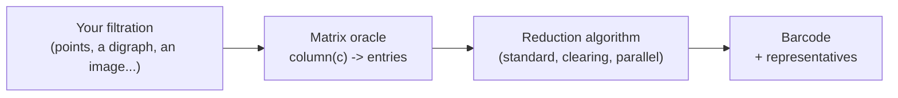

# Introduction

`phlite` is a Rust library for computing **persistent homology** of filtered chain complexes, with Python bindings
for three kinds of input. It began as a way to compute *grounded persistent path homology* of digraphs
([GrPPH](python/grpph.md)), and grew into a general framework in which the same reduction algorithms run on any
filtered chain complex you can describe, whether or not it fits in memory.

## The idea: matrices you never store

Every persistent homology computation boils down to reducing a big sparse matrix: the boundary matrix of the
filtration, or its transpose. Most libraries (PHAT, LoPHAT, Dionysus, GUDHI's matrix reductions, ...) want that
matrix *stored*, column by column, in filtration order, with integer row and column indices.

That is often impossible. The Vietoris–Rips complex of 1000 points up to dimension 2 has 166 million triangles and
41 billion tetrahedra; the path complex of a dense digraph is worse. Ripser's great insight was that you never need to
store the matrix: a column can be recomputed whenever it is needed, from a compact description of the cell (a few
integers), and most columns are never needed at all.

`phlite` turns that insight into a library. You describe your matrix as an **oracle**: a function that, given a
column's label (any type you like, not necessarily an integer), produces that column's entries on demand.

Everything else is optional help you can give the algorithms, and each piece unlocks a further optimisation:

| You provide | phlite can then |
|---|---|
| the column oracle, a filtration on rows, an ordered column basis | compute persistence with the standard algorithm |
| the basis split by dimension | use **clearing** |
| the transpose (or just "first column in each row") | recognise **apparent pairs**, skip most columns entirely |
| a fast way to find a column's pivot | finish most columns without building them (**emergent pairs**) |
| columns already sorted | add them without sorting |
| dense integer labels, and row ranks | use vectors instead of hash maps, and PHAT-style **pivot columns** |

The [tutorial](tutorial/index.md) walks through these one at a time on a concrete example.

## What is in the box

- **`phlite`**: the core library: the matrix traits and adaptors, the reduction algorithms (standard, clearing, and a
  lock-free parallel clearing after Morozov and Nigmetov), four representations of the column being reduced, a
  column cache, and helpers that turn a reduction into a barcode with representatives, by homology or cohomology.
- **`phlite_rips`**: Vietoris–Rips persistence, with Ripser's and giotto-ph's optimisations, as a Rust crate, a CLI
  and the `phlite_rips` Python package.
- **`phlite_grpph`**: grounded persistent path homology of weighted digraphs, as a crate and the `phlite_grpph`
  Python package.
- **`phlite_py`**: the `phlite` Python package, for explicit filtered chain complexes you build yourself: from
  integer columns, CSC arrays, or your own Python objects as cells. It is a drop-in alternative to PHAT and LoPHAT
  that also gives representatives and works over Z/p.

## How fast?

Measured on one thread against the specialised tools (see the [benchmarks](appendix/benchmarks.md)):

- **Vietoris–Rips**: on a par with ripser and giotto-ph, faster in dimension 2 on random points.
- **GrPPH**: 25–100× faster than grpphati.
- **Explicit complexes**: 7–13× faster than PHAT on Rips complexes, faster on sparse cell complexes, level on dense
  boundaries and meshes, and within about 10–20% on large cubical complexes.

## How to read this book

- [Background](background/persistence.md) recaps persistent homology as matrix reduction, using one small example
  that the rest of the book keeps coming back to.
- [How phlite is built](design/oracles.md) explains the oracle traits.
- The chapters on [reduction algorithms](algorithms/standard.md) and [column representations](columns/overview.md)
  explain every algorithm and trick: how it works, why it helps, and when it doesn't.
- [Inside phlite](internals/bookkeeping.md) covers the lower-level engineering, and where the time actually goes.
- The [tutorial](tutorial/index.md) builds a filtration of your own in Rust, step by step.
- The [Python chapters](python/index.md) document the three packages, with example notebooks. (The [API reference](api/index.html)
  is generated from their docstrings.)
