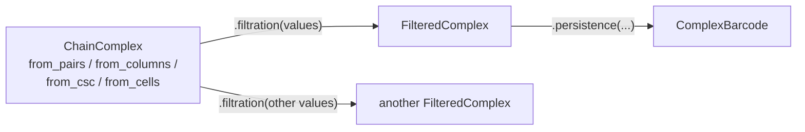

# phlite.complexes: explicit complexes

The `phlite-complexes` package (`phlite.complexes`, built from the `phlite_complexes` crate) computes persistence of
a filtered chain complex you build yourself. There are three steps:



## 1. Build a chain complex

A `ChainComplex` is the cells, their dimensions and their boundaries, with no filtration. It is validated once.

```python
from phlite.complexes import ChainComplex

# A hollow triangle on vertices 0, 1, 2, filled in by cell 6
pairs = [
    (0, []), (0, []), (0, []),        # vertices
    (1, [0, 1]), (1, [1, 2]), (1, [0, 2]),  # edges
    (2, [3, 4, 5]),                   # the triangle
]
chain = ChainComplex.from_pairs(pairs)
```

| Constructor | Takes | Notes |
|---|---|---|
| `from_pairs(pairs)` | `[(dimension, boundary), ...]` | as PHAT and LoPHAT |
| `from_columns(boundaries, dimensions)` | two lists | |
| `from_csc(indptr, indices, dimensions, data=None)` | numpy arrays | the fast path: no per-entry Python objects |
| `from_cells(cells, ...)` | your own objects (or tuples) with a dimension and a boundary | results come back as your objects |

All take `coefficients=` (per boundary entry) and `modulus=` (2, 3, 5, 7, 11 or 13).

**Your own cells.** Any hashable object with a `dimension` and a `boundary()` works (the same protocol as grpphati's
`Column`), or plain values with functions saying how to get the pieces:

```python
chain = ChainComplex.from_cells(
    simplices,                                   # tuples of vertices
    dimension=lambda s: len(s) - 1,
    boundary=lambda s: {s[:i] + s[i + 1:]: (-1) ** i for i in range(len(s))} if len(s) > 1 else {},
    modulus=3,
)
```

For large complexes of your own objects, `key=` (an injective map to integers) matches cells in Rust instead of
through Python hashing, `from_key=` avoids storing the objects at all, and `face_keys=True` lets `boundary` return
face keys rather than face objects (usually the real speed-up, since building face objects is the slow part).

## 2. Attach a filtration

```python
filtered = chain.filtration([0, 0, 0, 1, 1, 2, 3])      # one value per cell
```

Cells enter in order of value, ties broken by index; every face must enter no later than its cofaces (otherwise a
`ValueError` names the offending cells). `values` can be a sequence or numpy array (fastest), a mapping from cells
to values, a function of a cell, or omitted (cells' `entrance_time`, else their order). With `extend=True` missing
values are filled in as the maximum over the faces, so values on vertices give the **lower-star filtration**.

One chain complex can be filtered many times, cheaply: the validation and indexing are done once.

## 3. Compute persistence

```python
barcode = filtered.persistence(
    max_dim=None,            # default: the top dimension
    method="cohomology",     # or "homology"
    algorithm=None,          # a phlite.core.Algorithm, default Algorithm.serial()
    representatives=False,
)
```

The `ComplexBarcode` is in terms of your cells (unlike the other packages' `phlite.core.Barcode`, in terms of
values):

| | |
|---|---|
| `bars` | every bar: `dimension`, `birth`, `death`, `birth_value`, `death_value`, `persistence`, `is_essential`, `representative` |
| `pairings`, `essential` | `(birth, death)` cells of finite bars, births of infinite ones |
| `bar(cell)`, `representative(cell)` | the bar born at a cell |
| `diagram(dim)`, `diagrams()` | `(k, 2)` numpy arrays of `(birth, death)` values, `inf` for essential bars |

Representatives are `(cell, coefficient)` lists in decreasing filtration order, so the birth cell comes first. Bars of
length zero are omitted (with the default index filtration there are none, so you get every pair, as with PHAT).

## Choosing cell identifiers yourself

By default cells are matched up through a Python dict, using your `__hash__` and `__eq__`. You can instead give
`key=`, an injective map from cells to integers (e.g. a combinatorial encoding of a simplex), matched in a Rust hash map.

* `key=` lets cells be unhashable, and avoids your `__hash__`/`__eq__`, which helps when those are expensive.
* `from_key=` (the inverse of `key`) means the chain complex stores only keys, not cells, and rebuilds cells for
  results. (Value functions and mappings passed to `filtration` then see the rebuilt cells.)
* `face_keys=True` means `boundary` returns the keys of the faces rather than face objects. This is the real
  speed-up, since building face objects is usually the slowest part.

[`phlite_complexes/examples/cell_cost.py`](https://github.com/tomchaplin/phlite/blob/main/phlite_complexes/examples/cell_cost.py) builds the Vietoris-Rips complex of 300 random points (193k cells) from frozen dataclass
simplices, attaches their diameters as a numpy array, and computes H_0 and H_1:

| | build | filtration | memory kept |
|---|---|---|---|
| `from_columns` (indexing done by hand, in Python) | 152 ms | 24 ms | – |
| `from_cells`, hashing | 411 ms | 24 ms | 17.4 MB |
| `from_cells`, `key=` | 403 ms | 32 ms | 1.5 MB |
| `from_cells`, `key=`, `from_key=` | 424 ms | 23 ms | 0 MB |
| `from_cells`, `key=`, `face_keys=True` | 279 ms | 23 ms | 1.5 MB |

The reduction takes about 4 ms in every case. For simplices this cheap to hash, `key=` alone saves memory but not time:
most of the build is spent calling `boundary()`, which `face_keys=True` makes cheaper.

## Example: GrPPH

[`phlite_complexes/examples/grpph.py`](https://github.com/tomchaplin/phlite/blob/main/phlite_complexes/examples/grpph.py) implements grounded persistent path homology of a weighted digraph, as in
[grpphati](https://github.com/tomchaplin/grpphati), in about 60 lines. Cells are tagged tuples (`("e", a, b)`,
`("t", a, m, b)`, ...), the 2-cells are grpphati's filtration-adapted basis of the regular path complex, and the
boundaries are signed so it also works over Z/p:

```python
time = grpph_cells(G)  # {cell: entrance time}
chain = ChainComplex.from_cells(time.keys(), dimension=lambda c: DIMENSION[c[0]], boundary=boundary)
barcode = chain.filtration(time).persistence(max_dim=1)
```

It reproduces grpphati's README results: `[[0, 3]]` for its long square, and 4802 bars for the wedge of two complete
digraphs on 50 nodes (960k cells: 0.9 s to list the cells in Python, 1.4 s for `from_cells` and `filtration`, and the
reduction takes a few milliseconds). Representatives come back as paths, e.g.
`[(("e", 2, 3), 1), (("e", 1, 3), 1), (("e", 0, 2), 1), (("e", 0, 1), 1)]`.

Here the 2-cell basis depends on the filtration, so a new chain complex is built per digraph. Reusing a chain
complex pays off when one complex has many filtrations, like the lower-star example above.

## Why not matrix oracles written in Python?

It is tempting to let users implement `MatrixOracle` in Python, keeping `phlite`'s laziness.
Unfortunately the per-column cost of Python dwarfs everything else:
every column access would need the GIL, a Python call and a Python object per entry
(and the GIL would serialise the parallel algorithms).
`phlite` *recomputes* columns on demand rather than storing them, so this cost is paid many times per column.

[`phlite_complexes/examples/oracle_cost.py`](https://github.com/tomchaplin/phlite/blob/main/phlite_complexes/examples/oracle_cost.py) measures this on a Vietoris-Rips complex (vertices, edges, triangles) of random points in
the unit cube, computing H_0 and H_1. Merely calling the cheapest possible Python oracle (looking a column up in a
list, without crossing into Rust) *once* per column of the boundary and coboundary takes longer than `phlite`'s entire
cohomology reduction:

| points | cells | `phlite` cohomology (build + reduce) | one pass of Python oracle calls |
|---|---|---|---|
| 120 | 13k | 5.2 ms + 0.8 ms | 3.1 ms |
| 200 | 59k | 12.9 ms + 1.5 ms | 16.7 ms |
| 300 | 193k | 58.5 ms + 5.7 ms | 64.0 ms |

If your complex is too big to write down, the better route is a small Rust crate implementing the oracle,
as `phlite_clouds` and `phlite_networks` do, with its own Python package.

## Performance

The [explicit complexes](../internals/explicit.md) chapter explains how a filtered complex is laid out. Against
PHAT's twist reduction, on one thread with the matrix prebuilt:

| input | random | structured (long bars) |
|---|---|---|
| Rips complexes, by cohomology | phlite 11–14× faster | phlite 14–26× faster |
| cubical complexes | level to PHAT 1.2× faster | PHAT 1.1–1.2× faster |
| triangulated surfaces | | level |
| sparse cell complexes | phlite 1.1–2× faster | |
| dense boundaries | level to PHAT 1.4× faster | |

phlite uses more memory than PHAT, up to 4.5× on Rips complexes, since it also keeps the transpose. Its parallel
reduction doesn't pay off here: serial clearing with pivot columns and stored R is faster on every one of these inputs.

See the [notebooks](notebooks.md) for worked examples: an image, a point cloud's alpha-like complex, and a lower-star
filtration on a mesh.
