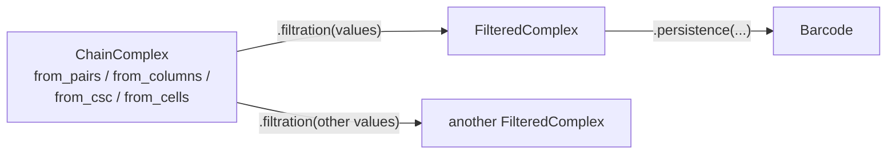

# phlite: explicit complexes

The `phlite` package computes persistence of a filtered chain complex you build yourself. There are three steps:



## 1. Build a chain complex

A `ChainComplex` is the cells, their dimensions and their boundaries, with no filtration. It is validated once.

```python
import phlite

# A hollow triangle on vertices 0, 1, 2, filled in by cell 6
pairs = [
    (0, []), (0, []), (0, []),        # vertices
    (1, [0, 1]), (1, [1, 2]), (1, [0, 2]),  # edges
    (2, [3, 4, 5]),                   # the triangle
]
chain = phlite.ChainComplex.from_pairs(pairs)
```

| Constructor | Takes | Notes |
|---|---|---|
| `from_pairs(pairs)` | `[(dimension, boundary), ...]` | as PHAT and LoPHAT |
| `from_columns(boundaries, dimensions)` | two lists | |
| `from_csc(indptr, indices, dimensions, data=None)` | numpy arrays | the fast path: no per-entry Python objects |
| `from_cells(cells, ...)` | your own objects (or tuples) with a dimension and a boundary | results come back as your objects |

All take `coefficients=` (per boundary entry) and `modulus=` (2, 3, 5, 7, 11 or 13).

**Your own cells.** Any hashable object with a `dimension` and a `boundary()` works (the same protocol as grpphati's
`Column`), or plain values with functions saying how to get the pieces:

```python
chain = phlite.ChainComplex.from_cells(
    simplices,                                   # tuples of vertices
    dimension=lambda s: len(s) - 1,
    boundary=lambda s: {s[:i] + s[i + 1:]: (-1) ** i for i in range(len(s))} if len(s) > 1 else {},
    modulus=3,
)
```

For large complexes of your own objects, `key=` (an injective map to integers) matches cells in Rust instead of
through Python hashing, `from_key=` avoids storing the objects at all, and `face_keys=True` lets `boundary` return
face keys rather than face objects (usually the real speed-up, since building face objects is the slow part).

## 2. Attach a filtration

```python
filtered = chain.filtration([0, 0, 0, 1, 1, 2, 3])      # one value per cell
```

Cells enter in order of value, ties broken by index; every face must enter no later than its cofaces (otherwise a
`ValueError` names the offending cells). `values` can be a sequence or numpy array (fastest), a mapping from cells
to values, a function of a cell, or omitted (cells' `entrance_time`, else their order). With `extend=True` missing
values are filled in as the maximum over the faces, so values on vertices give the **lower-star filtration**.

One chain complex can be filtered many times, cheaply: the validation and indexing are done once.

## 3. Compute persistence

```python
barcode = filtered.persistence(
    max_dim=None,            # default: the top dimension
    method="cohomology",     # or "homology"
    algorithm=None,          # an Algorithm, default Algorithm.serial()
    representatives=False,
)
```

The `Barcode` is in terms of your cells:

| | |
|---|---|
| `bars` | every bar: `dimension`, `birth`, `death`, `birth_value`, `death_value`, `persistence`, `is_essential`, `representative` |
| `pairings`, `essential` | `(birth, death)` cells of finite bars, births of infinite ones |
| `bar(cell)`, `representative(cell)` | the bar born at a cell |
| `diagram(dim)`, `diagrams()` | `(k, 2)` numpy arrays of `(birth, death)` values, `inf` for essential bars |

Representatives are `(cell, coefficient)` lists in decreasing filtration order, so the birth cell comes first. Bars of
length zero are omitted (with the default index filtration there are none, so you get every pair, as with PHAT).

## Performance

The [explicit complexes](../internals/explicit.md) chapter explains how a filtered complex is laid out. Against
PHAT's twist reduction, on one thread with the matrix prebuilt:

| input | random | structured (long bars) |
|---|---|---|
| Rips complexes, by cohomology | phlite 7–10× faster | phlite 9–13× faster |
| cubical complexes | PHAT 1.1–1.2× faster | PHAT 1.2–1.3× faster |
| triangulated surfaces | | level to PHAT 1.1× faster |
| sparse cell complexes | phlite 1.1–2× faster | |
| dense boundaries | level | |

See the [notebooks](notebooks.md) for worked examples: an image, a point cloud's alpha-like complex, and a lower-star
filtration on a mesh.
