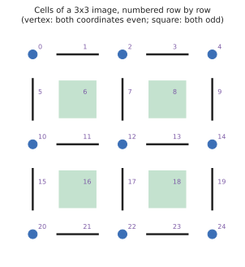

# Tutorial: your own filtration in Rust

This tutorial builds persistent homology for a filtration `phlite` has never seen: the **cubical complex of a 3D
greyscale volume** (a CT scan, a simulation, a 3D image), with the lower-star filtration: a cell appears with its
brightest voxel. It starts with the least you can implement, and each step adds a piece that unlocks an optimisation.

## When is a lazy oracle the right tool?

`phlite`'s oracles never store the matrix, and that pays off when **most of the matrix never needs touching**, not
merely when it wouldn't fit in memory:

- **Most pairs are zero-length apparent pairs.** In a lower-star filtration nearly every cell is paired with a
  neighbour that appears at the same moment; in Vietoris–Rips nearly every simplex is. Such cells needn't be
  reduced, recorded, or even listed ([apparent pairs](../algorithms/apparent-pairs.md)).
- **The top dimension needn't be enumerated.** Cohomology only meets the top cells as rows, produced on demand.
- **Columns are cheap to compute** from a compact label, so recomputing them costs less than storing them.

Vietoris–Rips complexes often fit in memory, and storing them is still the wrong choice: they are huge, sparse and
almost entirely apparent pairs. The opposite case is a complex where **many columns need genuine reduction**: dense
boundaries, or cubical complexes of pure noise. There the work is in adding columns, and PHAT's tricks (dense indices,
pivot columns, storing R) win. For those, build the complex explicitly with the [`phlite` Python package](../python/phlite.md)
(which applies all of them), or use PHAT.

A smooth 3D volume is in the lazy camp: in the example below, 94.5% of the cells are in zero-length apparent pairs.

| Step | You implement | You unlock |
|---|---|---|
| [1](step1.md) | a cell label and a boundary oracle | homology (Betti numbers), standard algorithm |
| [2](step2.md) | a filtration and a column basis | persistent homology |
| [3](step3.md) | a coboundary oracle | cohomology and clearing: the top dimension is never listed |
| [4](step4.md) | (attach the transpose) | apparent pairs |
| [5](step5.md) | the optional hooks | emergent pairs, cheap apparent pairs |
| [6](step6.md) | a basis without zero-length apparent pairs | a basis 18× smaller, a quarter of the memory |
| [7](step7.md) | (attach the transpose; turn on threads) | representatives, parallel reduction |

The code is two examples in the `phlite` crate, sharing the volume and its geometry:

```sh
cargo run --release -p phlite --example volume_basic                       # steps 1–4
cargo run --release -p phlite --example volume_lazy --features parallel    # steps 5–7
```

## The complex

Voxels are vertices. Between two adjacent voxels is an edge, between four a square, between eight a cube. It is
convenient to put every cell on a grid twice as fine as the volume: a coordinate that is odd spans two voxels, so a
cell's **dimension is its number of odd coordinates**. Here is the same idea in 2D:


<p class="caption">In 2D: a vertex where both coordinates are even, an edge where one is odd, a square where both are.
The volume adds a third coordinate.</p>

Numbering the grid point by point gives every cell a `u64`. A cell's **faces** are one step either way along each odd
coordinate, and its **cofaces** one step either way along each even coordinate, so both are computed from the number
alone. Nothing about the complex is stored but the voxels:

```rust,ignore
{{#include ../../../../phlite/examples/volume/volume.rs:geometry}}
```

The cofaces are produced in increasing order of their numbers, which [step 5](step5.md) puts to use.
