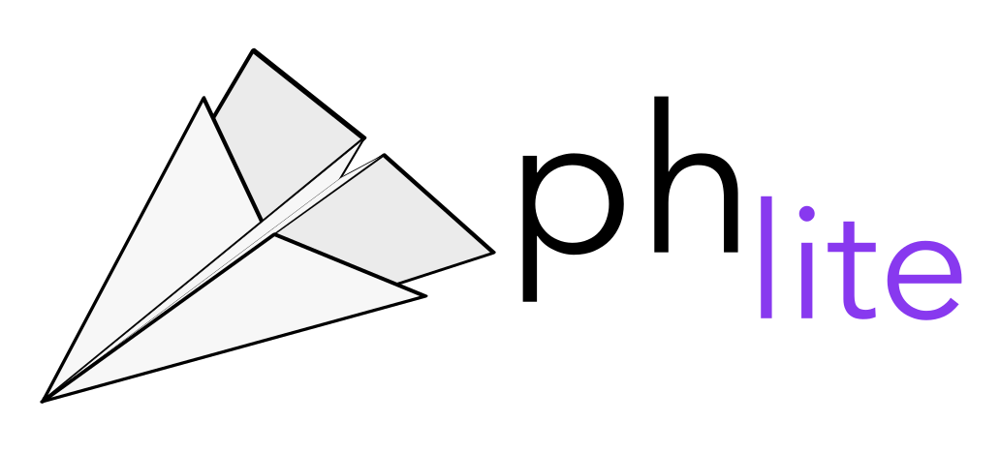

<h1>phlite</h1>

Persistent homology that's light on memory usage: the core crate.

This is the core of [phlite](https://github.com/tomchaplin/phlite): a framework for computing persistent homology of
**any** filtration with the techniques that make [Ripser](https://github.com/Ripser/ripser) fast and lean. The
[phlite project](https://github.com/tomchaplin/phlite) builds ready-made filtrations on it (point clouds, networks,
images, explicit complexes, in Rust and Python), documented in [the book](https://phlite.tomchaplin.xyz/book/), with an
[in-browser playground](https://phlite.tomchaplin.xyz/playground/). Use this crate directly to compute the persistent
homology of a filtration of your own.

## What it does

You describe your filtration's boundary (or coboundary) matrix as a **matrix oracle**: a type that, given a column
index, lists that column's non-zero entries. Rows and columns are indexed by whatever type suits you (Ripser's
simplices encoded as integers, tuples of vertices, paths in a graph), and columns are computed on demand rather than
stored. phlite then reduces it (`R = D V`) and reads off the barcode, using whichever optimisations your oracle makes
possible:

* **Clearing and cohomology** ([`reduction::Clearing`](https://docs.rs/phlite/latest/phlite/reduction/), `barcode::cohomology`):
  give a basis split by dimension.
* **Apparent and emergent pairs**: attach the transpose of your matrix, and most columns need no reduction or storage;
  override `column_pivot` if you can find a column's pivot without listing it.
* **Storing V, not R** (recomputing columns of R from your oracle), or storing R when that's faster.
* **Parallel clearing**, lock-free or locking (feature `parallel`, and `lock-free`).
* **Several working-column representations** (heaps, lazily merged sorted columns, sorted vectors, PHAT's bit-tree
  pivot columns), with an optional cache of columns of D.
* **Representatives** for every bar, by homology or (via the involution) cohomology, over any prime field.
* **Extended persistence** of any filtration with a reverse filtration ([`extended`](https://docs.rs/phlite/latest/phlite/extended/)).
* **Maps of filtrations** ([`six_pack`](https://docs.rs/phlite/latest/phlite/six_pack/), [`image_kernel`](https://docs.rs/phlite/latest/phlite/image_kernel/)):
  implement `FilteredChainMap` for any two oracles and a map between them, and get the barcodes of its image, kernel
  and cokernel (Cohen-Steiner, Edelsbrunner, Harer and Morozov, as phimaker), of both filtrations and of the mapping
  cone, with representatives, through a lazy mapping cylinder.
* **Over the integers** ([`integral_persistence`](https://docs.rs/phlite/latest/phlite/integral_persistence/),
  [`integral`](https://docs.rs/phlite/latest/phlite/integral/)): the barcode over Q and the primes of the torsion
  (as Perseus finds them), and exact groups, by checked integer elimination.
* **Spectral sequences** ([`spectral`](https://docs.rs/phlite/latest/phlite/spectral/)): entry by entry, read off a
  barcode over a field or computed from a window of any `StepFiltered` oracle over Z.
* **A contract checker** ([`matrices::contract`](https://docs.rs/phlite/latest/phlite/matrices/contract/)) that tests
  your oracle satisfies everything the algorithms assume.

Each optimisation is optional, and [the book](https://phlite.tomchaplin.xyz/book/) explains when each one helps.

## Getting started

The [tutorial](https://phlite.tomchaplin.xyz/book/tutorial/index.html) implements a filtration (cubical complexes of a
volume) step by step, adding one optimisation at a time and measuring each: a boundary matrix, a filtration and basis,
cohomology and clearing, apparent pairs, cheaper pivots, dense indices and pivot columns, then representatives and
threads. Its code is [`examples/volume_basic.rs`](https://github.com/tomchaplin/phlite/blob/main/phlite/examples/volume_basic.rs)
and [`examples/volume_lazy.rs`](https://github.com/tomchaplin/phlite/blob/main/phlite/examples/volume_lazy.rs). The
[crate documentation](https://docs.rs/phlite) lists the traits and what each method is for, and the Vietoris–Rips
implementation in [`phlite_clouds`](https://github.com/tomchaplin/phlite/tree/main/phlite_clouds) is a complete,
optimised example.

## Compared with other libraries

phlite's techniques come from other software, cited in [the main README](https://github.com/tomchaplin/phlite#standing-on-the-shoulders-of-others):
chiefly [Ripser](https://github.com/Ripser/ripser) (cohomology, clearing, apparent and emergent pairs, storing V),
[giotto-ph](https://github.com/giotto-ai/giotto-ph) and Morozov and Nigmetov (parallel lock-free reduction),
[OAT](https://github.com/OpenAppliedTopology/oat_rust) (merged columns) and [PHAT](https://github.com/blazs/phat)
(pivot columns, storing R).

* **Ripser, giotto-ph, Cubical Ripser, flagser** are each specialised to one filtration. phlite's own Vietoris–Rips
  is on a par with ripser and giotto-ph (faster in dimension 2 on random points, slower in dimension 1 alone), so the
  generality costs little; but for exactly those filtrations they are mature, well-tested choices.
* **[OAT](https://github.com/OpenAppliedTopology/oat_rust)** (Open Applied Topology) is the closest in spirit: a Rust
  library of lazy matrix oracles for persistent homology, with a much broader linear algebra toolkit (and phlite's
  merged columns are its idea). phlite concentrates on the performance techniques of the Ripser family and on
  ready-made pipelines.
* **[PHAT](https://github.com/blazs/phat), [LoPHAT](https://github.com/tomchaplin/lophat)** reduce explicit boundary
  matrices; phlite's [`phlite_complexes`](https://github.com/tomchaplin/phlite/tree/main/phlite_complexes) does too, and is
  faster than PHAT on most inputs we tried and slower on cubical complexes.
* **[GUDHI](https://gudhi.inria.fr)** is a large C++/Python library with many complexes and much more than persistence;
  phlite covers fewer filtrations, aims at speed and memory on them, and lets you add your own.
* **[Ripserer.jl](https://github.com/mtsch/Ripserer.jl)** shares phlite's aim of extending Ripser's techniques to new
  filtrations, in Julia.

[Benchmarks](https://phlite.tomchaplin.xyz/book/appendix/benchmarks.html) compare every pipeline with these.

## Features

* `parallel`: `Clearing::parallel()` (rayon).
* `lock-free`: the lock-free storage for parallel clearing (papaya and arc-swap).
* `storage-experiments`: every concurrent data structure we benchmarked, for rerunning that comparison (unstable).
