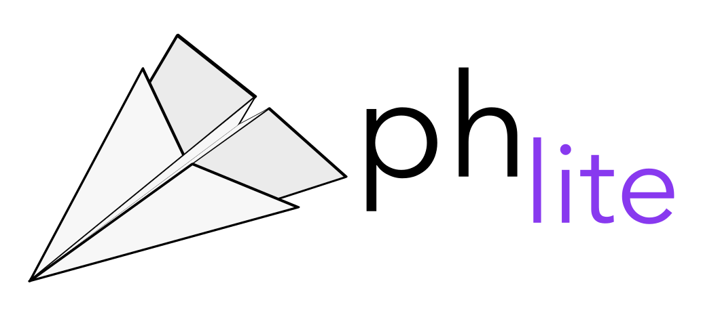

<div align="center">



**Persistent homology that's light on memory usage.**

[Documentation](https://phlite.tomchaplin.xyz/book/) ·
[Playground](https://phlite.tomchaplin.xyz/playground/) ·
[Python API](https://phlite.tomchaplin.xyz/api/) ·
[GitHub](https://github.com/tomchaplin/phlite)

</div>

phlite brings the techniques that make [Ripser](https://github.com/Ripser/ripser) and its relatives fast and lean
(cohomology, clearing, apparent and emergent pairs, lock-free parallel reduction) to any filtration, not just
Vietoris–Rips. `pip install phlite` installs every package; each kind of input has its own, sharing the namespace
`phlite`:

```python
from phlite.clouds import rips

barcode = rips(points=X, max_dim=1)    # X: an (n, d) numpy array
barcode.pairings[1]                    # (birth, death) of the finite H1 bars
```

| Package | For |
|---|---|
| [`phlite-clouds`](https://pypi.org/project/phlite-clouds/) (`phlite.clouds`) | point clouds and distance matrices: Vietoris–Rips (dense or sparse), weighted and DTM-Rips, alpha and Delaunay–Čech complexes |
| [`phlite-networks`](https://pypi.org/project/phlite-networks/) (`phlite.networks`) | weighted graphs and digraphs: (grounded) path homology, directed flag, Dowker and ordered-tuple complexes, flag complexes |
| [`phlite-images`](https://pypi.org/project/phlite-images/) (`phlite.images`) | images and volumes: cubical complexes |
| [`phlite-complexes`](https://pypi.org/project/phlite-complexes/) (`phlite.complexes`) | any chain complex you build, with any filtration, and extended persistence |
| [`phlite-core`](https://pypi.org/project/phlite-core/) (`phlite.core`) | what they share: `Algorithm` and `Barcode` |

Try it without installing anything in the [playground](https://phlite.tomchaplin.xyz/playground/), which runs phlite in
your browser. The [book](https://phlite.tomchaplin.xyz/book/) explains each pipeline, how it compares with ripser,
giotto-ph, GUDHI, flagser, Cubical Ripser and PHAT (whose techniques phlite builds on), and how phlite works.
